# Argyle

[← All variants](README.md) · [Puzzles](../features-puzzles.md) · [How to play](../how-to-play.md)

## The rules

[Classic](classic.md) rules, plus **eight diagonal lines** in an argyle (diamond) pattern: **no digit repeats along a line**. Four run down to the right, from r1c2, r1c5, r2c1 and r5c1, and four mirror them, down to the left from r1c8, r1c5, r2c9 and r5c9. The long ones have 8 cells and the short ones 5, so unlike X-Sudoku's diagonals they don't hold every digit.

## On the board

- The lines are thin translucent lines in the accent colour, corner to corner across their cells, under the digits.
- Two equal digits on a line turn red, like a repeat in a row.
- Conflicts, hints and the grader count the lines as cells that see each other: "row, column, box or argyle line".
- **Puzzles → ⋮ → New puzzle → Grids → Argyle**.

## How to solve it

- **More cells see each other:** a cell on a line sees up to 7 more cells than in Classic; a cell where two lines cross, up to 12. Check the lines before writing in a candidate.
- **No "every digit" on a line:** a line of 8 misses one digit and a line of 5 misses four, so a line never gives a hidden single by itself. Use it to rule digits out of cells.
- **The crossings:** two lines meet in 8 cells: r1c5, r5c1, r5c9 and r9c5 (where the short lines start and end) and r4c5, r5c4, r5c6, r6c5 around the centre. They see the most, so they're often the first to have one candidate left.

## Worked example

**variant-examples #42**, Argyle Easy (see [Classic](classic.md#worked-example-the-whole-puzzle) for how to import the examples; cells are written r*row*c*column*). The lines are in the screenshot; three matter here:

- the long line from r1c2 down to the right (r1c2, r2c3, r3c4, r4c5, r5c6, r6c7, r7c8, r8c9);
- the short line from r1c5 down to the left (r1c5, r2c4, r3c3, r4c2, r5c1);
- the long line from r2c1 down to the right (r2c1, r3c2, r4c3, r5c4, r6c5, r7c6, r8c7, r9c8).

**Step 1: r3c4.** Row 3 has 1, 4, 5, 6 and 9; column 4 has 3 and 7; that leaves 2 and 8. r3c4 is on the long line from r1c2, which has an 8 in r5c6. **r3c4 = 2**.

**Step 2: r4c2.** Row 4 has 1, 3, 6, 7 and 8; box 4 has a 4; column 2 has a 9; that leaves 2 and 5. r4c2 is on the short line from r1c5, which has a 5 in r3c3. **r4c2 = 2**.

**Step 3: r7c6.** Row 7 has 2, 3, 4, 6 and 8; column 6 has 1 and 5; that leaves 7 and 9. r7c6 is on the long line from r2c1, which has a 9 in r2c1. **r7c6 = 7**.

## The whole puzzle, step by step

<!-- walkthrough -->
<!-- Written by tools/walkthrough.py argyle: edit the script, not this part. -->

The whole puzzle, from the start to the last cell: 47 steps, each one a single (one place left for a digit, or one digit left for a cell), taken in the order a box's single comes first, so not quite the order of the worked example above. In each picture, the unit the step looks at is tinted yellow (for a cell with one digit left: its row, column and box), the new digit is on green, the digits that rule cells out have an **orange ring**, and the empty cells they rule out a **red cross**. Givens are on grey, digits from earlier steps in blue.

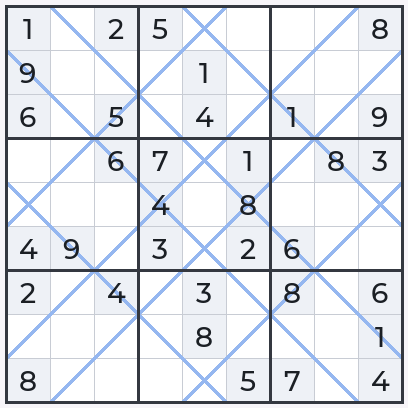

#### Step 1: the 8 in box 2

Box 2 needs an 8. r1c5 and r1c6: row 1 has one (r1c9). r2c6 and r3c6: column 6 has one (r5c6). r3c4: the 8 in r5c6 is on the same argyle line. Only **r2c4** is left: **r2c4 = 8**.

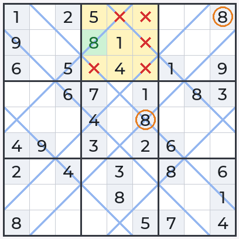

#### Step 2: the 8 in box 1

Box 1 needs an 8. r1c2: row 1 has one (r1c9). r2c2 and r2c3: row 2 has one (r2c4). Only **r3c2** is left: **r3c2 = 8**.

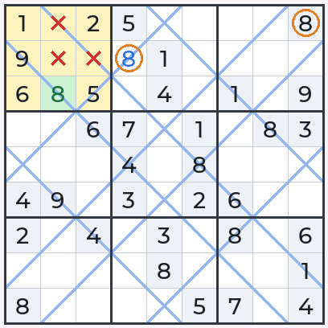

#### Step 3: the 2 in box 2

Box 2 needs a 2. r1c5 and r1c6: row 1 has one (r1c3). r2c6 and r3c6: column 6 has one (r6c6). Only **r3c4** is left: **r3c4 = 2**.

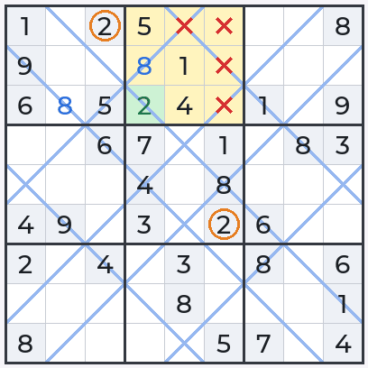

#### Step 4: the 8 in box 4

Box 4 needs an 8. r4c1 and r4c2: row 4 has one (r4c8). r5c1, r5c2 and r5c3: row 5 has one (r5c6). Only **r6c3** is left: **r6c3 = 8**.

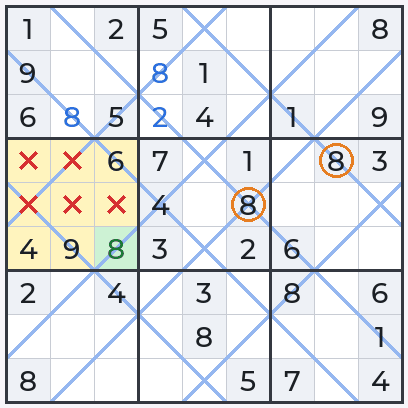

#### Step 5: the 6 in box 5

Box 5 needs a 6. r4c5: row 4 has one (r4c3). r6c5: row 6 has one (r6c7). Only **r5c5** is left: **r5c5 = 6**.

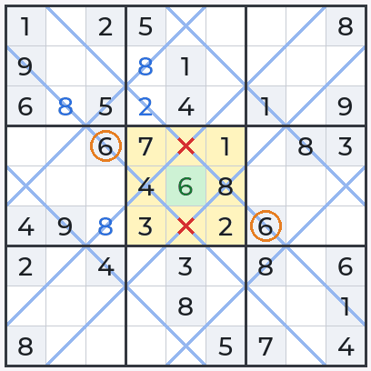

#### Step 6: the 9 in box 5

Box 5 needs a 9. r6c5: row 6 has one (r6c2). Only **r4c5** is left: **r4c5 = 9**.

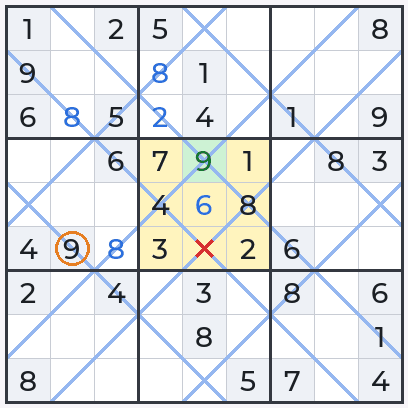

#### Step 7: the 9 in box 2

Box 2 needs a 9. r1c5: column 5 has one (r4c5). r2c6: row 2 has one (r2c1). r3c6: row 3 has one (r3c9). Only **r1c6** is left: **r1c6 = 9**.

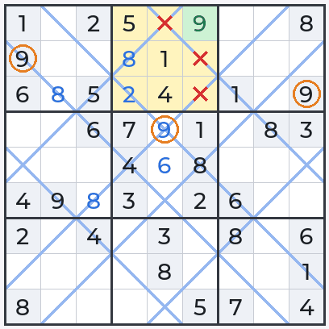

#### Step 8: the 6 in box 2

Box 2 needs a 6. r1c5: column 5 has one (r5c5). r3c6: row 3 has one (r3c1). Only **r2c6** is left: **r2c6 = 6**.

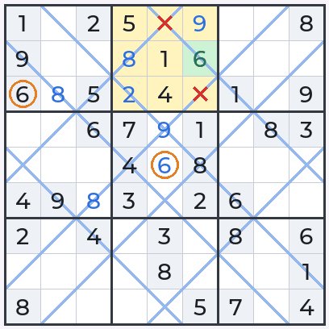

#### Step 9: the 3 in box 2

Box 2 needs a 3. r1c5: column 5 has one (r7c5). Only **r3c6** is left: **r3c6 = 3**.

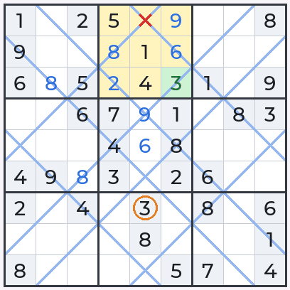

#### Step 10: the 7 in box 2

Box 2 needs a 7, and r1c5 is its last empty cell: **r1c5 = 7**.

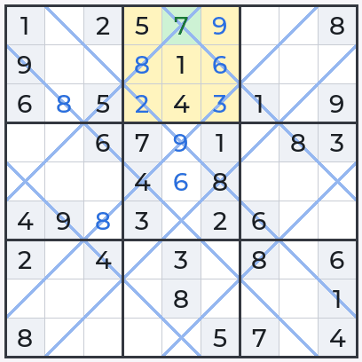

#### Step 11: the 6 in box 3

Box 3 needs a 6. r1c7: column 7 has one (r6c7). r2c7, r2c8 and r2c9: row 2 has one (r2c6). r3c8: row 3 has one (r3c1). Only **r1c8** is left: **r1c8 = 6**.

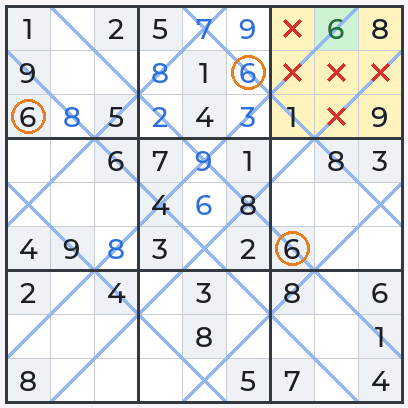

#### Step 12: the 5 in box 5

Box 5 needs a 5, and r6c5 is its last empty cell: **r6c5 = 5**.

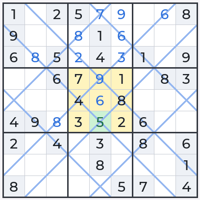

#### Step 13: the 4 in box 6

Box 6 needs a 4. r5c7, r5c8 and r5c9: row 5 has one (r5c4). r6c8 and r6c9: row 6 has one (r6c1). Only **r4c7** is left: **r4c7 = 4**.

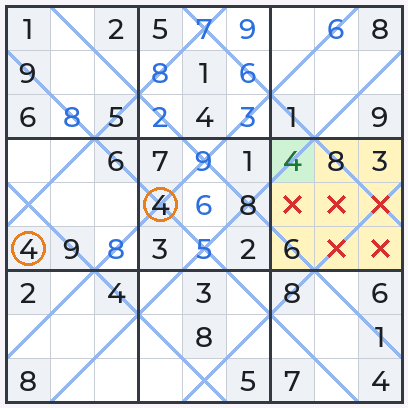

#### Step 14: the 4 in box 3

Box 3 needs a 4. r1c7 and r2c7: column 7 has one (r4c7). r2c9: column 9 has one (r9c9). r3c8: row 3 has one (r3c5). Only **r2c8** is left: **r2c8 = 4**.

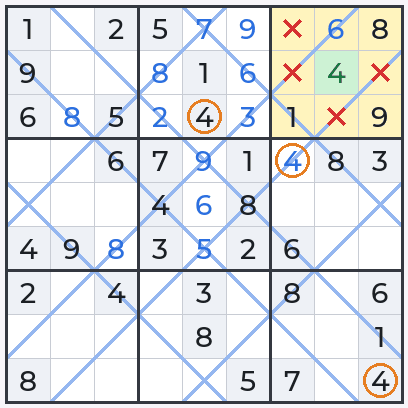

#### Step 15: the 4 in box 1

Box 1 needs a 4. r2c2 and r2c3: row 2 has one (r2c8). Only **r1c2** is left: **r1c2 = 4**.

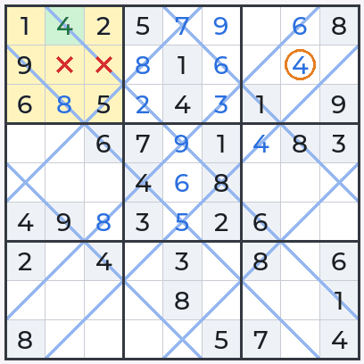

#### Step 16: the 3 in box 3

Box 3 needs a 3. r2c7: the 3 in r3c6 is on the same argyle line. r2c9: column 9 has one (r4c9). r3c8: row 3 has one (r3c6). Only **r1c7** is left: **r1c7 = 3**.

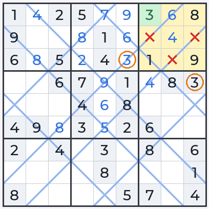

#### Step 17: the 5 in box 3

Box 3 needs a 5. r2c9: the 5 in r6c5 is on the same argyle line. r3c8: row 3 has one (r3c3). Only **r2c7** is left: **r2c7 = 5**.

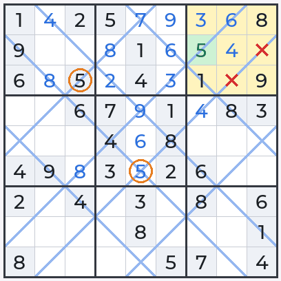

#### Step 18: the 2 in box 3

Box 3 needs a 2. r3c8: row 3 has one (r3c4). Only **r2c9** is left: **r2c9 = 2**.

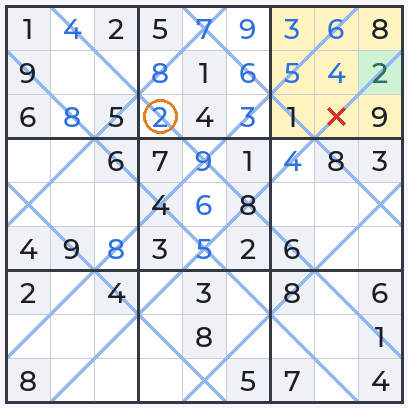

#### Step 19: the 7 in box 3

Box 3 needs a 7, and r3c8 is its last empty cell: **r3c8 = 7**.

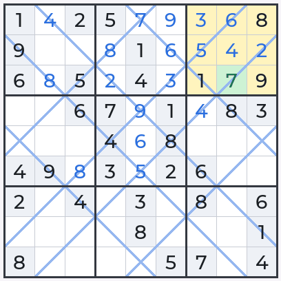

#### Step 20: the 7 in box 6

Box 6 needs a 7. r5c7: column 7 has one (r9c7). r5c8 and r6c8: column 8 has one (r3c8). r5c9: the 7 in r1c5 is on the same argyle line. Only **r6c9** is left: **r6c9 = 7**.

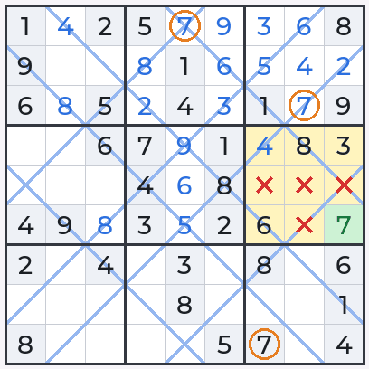

#### Step 21: the 5 in box 7

Box 7 needs a 5. r7c2 and r8c1: the 5 in r2c7 is on the same argyle line. r8c3: column 3 has one (r3c3). r9c2 and r9c3: row 9 has one (r9c6). Only **r8c2** is left: **r8c2 = 5**.

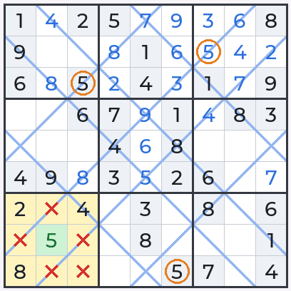

#### Step 22: the 5 in box 4

Box 4 needs a 5. r4c2 and r5c2: column 2 has one (r8c2). r5c1: the 5 in r3c3 is on the same argyle line. r5c3: column 3 has one (r3c3). Only **r4c1** is left: **r4c1 = 5**.

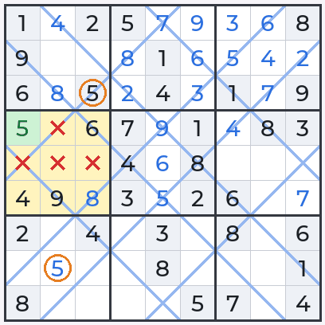

#### Step 23: the 6 in box 7

Box 7 needs a 6. r7c2: row 7 has one (r7c9). r8c1: column 1 has one (r3c1). r8c3 and r9c3: column 3 has one (r4c3). Only **r9c2** is left: **r9c2 = 6**.

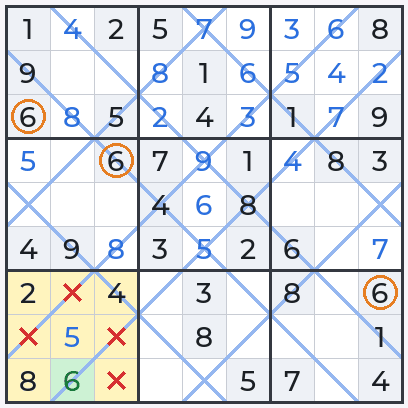

#### Step 24: the 2 in box 8

Box 8 needs a 2. r7c4 and r7c6: row 7 has one (r7c1). r8c4 and r9c4: column 4 has one (r3c4). r8c6: column 6 has one (r6c6). Only **r9c5** is left: **r9c5 = 2**.

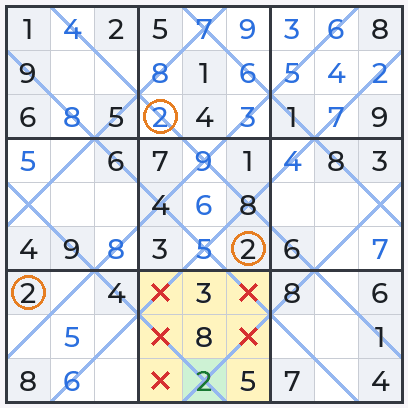

#### Step 25: the 4 in box 8

Box 8 needs a 4. r7c4 and r7c6: row 7 has one (r7c3). r8c4: column 4 has one (r5c4). r9c4: row 9 has one (r9c9). Only **r8c6** is left: **r8c6 = 4**.

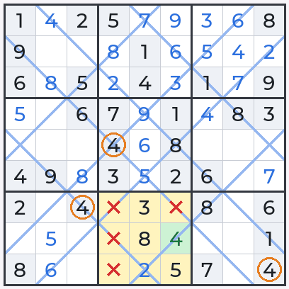

#### Step 26: the 6 in box 8

Box 8 needs a 6. r7c4 and r7c6: row 7 has one (r7c9). r9c4: row 9 has one (r9c2). Only **r8c4** is left: **r8c4 = 6**.

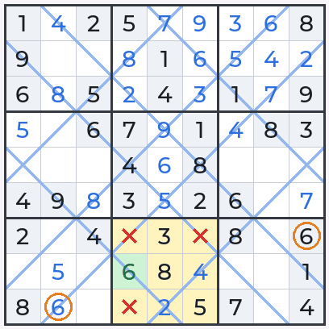

#### Step 27: the 7 in box 8

Box 8 needs a 7. r7c4: column 4 has one (r4c4). r9c4: row 9 has one (r9c7). Only **r7c6** is left: **r7c6 = 7**.

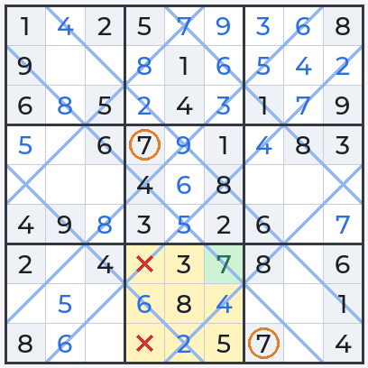

#### Step 28: the 7 in box 7

Box 7 needs a 7. r7c2: row 7 has one (r7c6). r8c3: the 7 in r3c8 is on the same argyle line. r9c3: row 9 has one (r9c7). Only **r8c1** is left: **r8c1 = 7**.

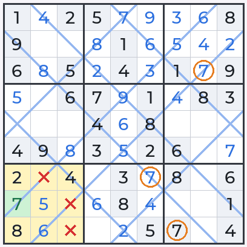

#### Step 29: the 5 in box 9

Box 9 needs a 5. r8c7 and r8c8: row 8 has one (r8c2). r9c8: row 9 has one (r9c6). Only **r7c8** is left: **r7c8 = 5**.

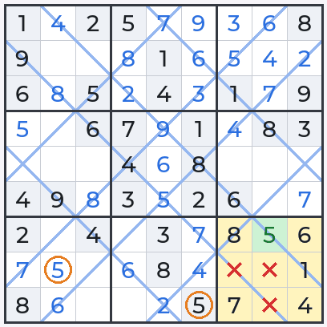

#### Step 30: the 5 in box 6

Box 6 needs a 5. r5c7: column 7 has one (r2c7). r5c8: column 8 has one (r7c8). r6c8: row 6 has one (r6c5). Only **r5c9** is left: **r5c9 = 5**.

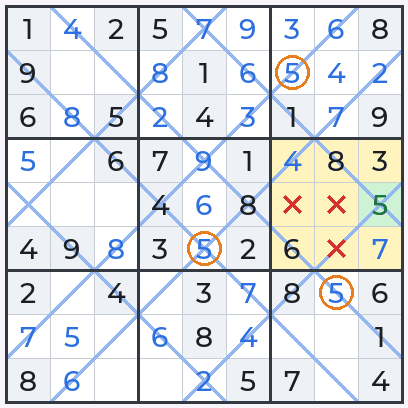

#### Step 31: the 9 in box 9

Box 9 needs a 9. r8c7 and r9c8: the 9 in r2c1 is on the same argyle line. Only **r8c8** is left: **r8c8 = 9**.

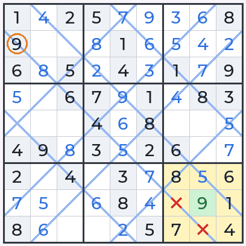

#### Step 32: the 9 in box 6

Box 6 needs a 9. r5c8: column 8 has one (r8c8). r6c8: row 6 has one (r6c2). Only **r5c7** is left: **r5c7 = 9**.

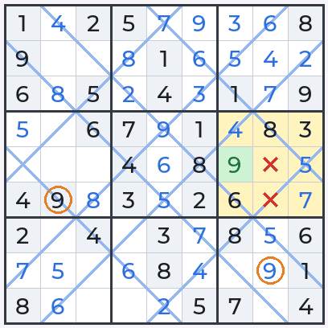

#### Step 33: the 2 in box 6

Box 6 needs a 2. r6c8: row 6 has one (r6c6). Only **r5c8** is left: **r5c8 = 2**.

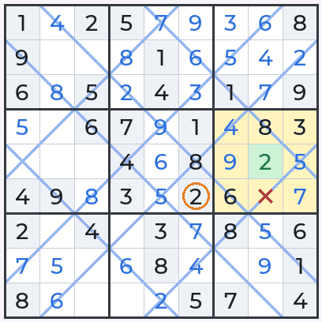

#### Step 34: the 2 in box 4

Box 4 needs a 2. r5c1, r5c2 and r5c3: row 5 has one (r5c8). Only **r4c2** is left: **r4c2 = 2**.

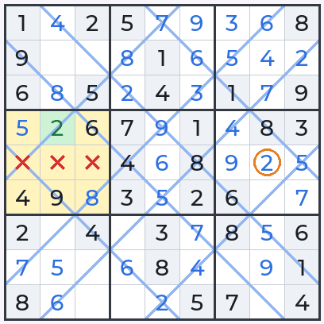

#### Step 35: the 1 in box 6

Box 6 needs a 1, and r6c8 is its last empty cell: **r6c8 = 1**.

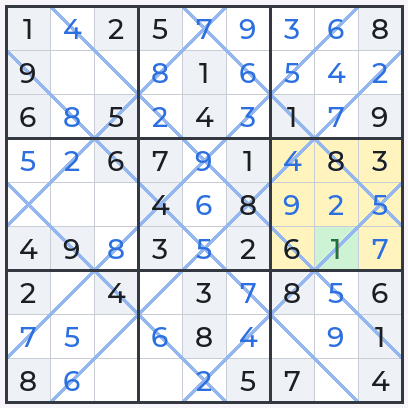

#### Step 36: the 9 in box 7

Box 7 needs a 9. r7c2: column 2 has one (r6c2). r8c3: row 8 has one (r8c8). Only **r9c3** is left: **r9c3 = 9**.

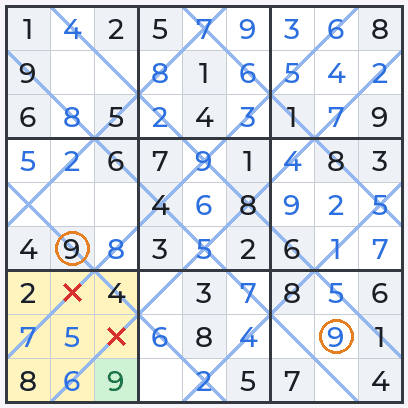

#### Step 37: the 1 in box 7

Box 7 needs a 1. r8c3: row 8 has one (r8c9). Only **r7c2** is left: **r7c2 = 1**.

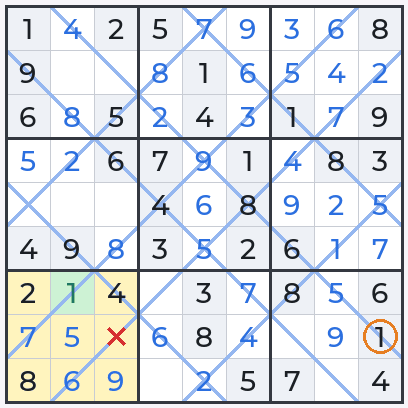

#### Step 38: the 1 in box 4

Box 4 needs a 1. r5c1: column 1 has one (r1c1). r5c2: column 2 has one (r7c2). Only **r5c3** is left: **r5c3 = 1**.

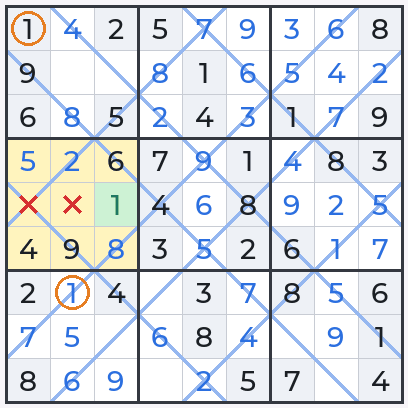

#### Step 39: the 7 in box 4

Box 4 needs a 7. r5c1: column 1 has one (r8c1). Only **r5c2** is left: **r5c2 = 7**.

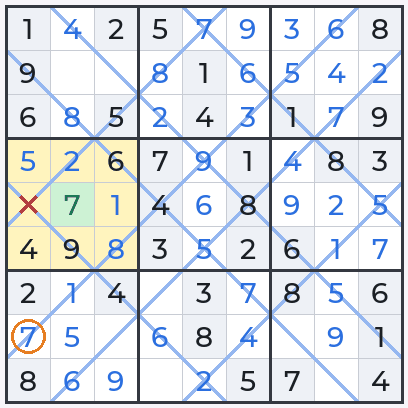

#### Step 40: the 7 in box 1

Box 1 needs a 7. r2c2: column 2 has one (r5c2). Only **r2c3** is left: **r2c3 = 7**.

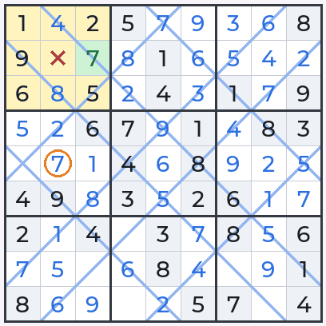

#### Step 41: the 3 in box 1

Box 1 needs a 3, and r2c2 is its last empty cell: **r2c2 = 3**.

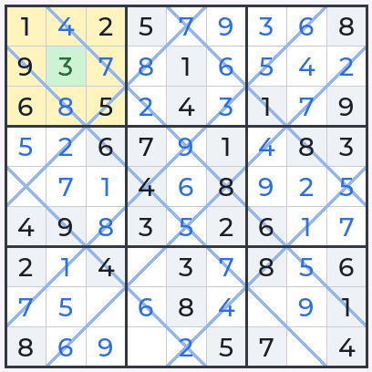

#### Step 42: the 3 in box 4

Box 4 needs a 3, and r5c1 is its last empty cell: **r5c1 = 3**.

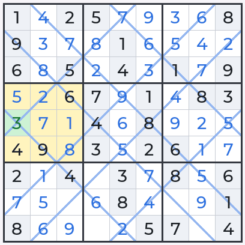

#### Step 43: the 3 in box 7

Box 7 needs a 3, and r8c3 is its last empty cell: **r8c3 = 3**.

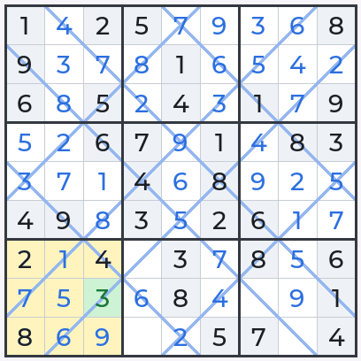

#### Step 44: the 1 in box 8

Box 8 needs a 1. r7c4: row 7 has one (r7c2). Only **r9c4** is left: **r9c4 = 1**.

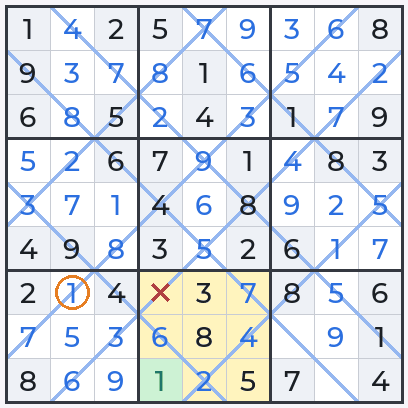

#### Step 45: the 9 in box 8

Box 8 needs a 9, and r7c4 is its last empty cell: **r7c4 = 9**.

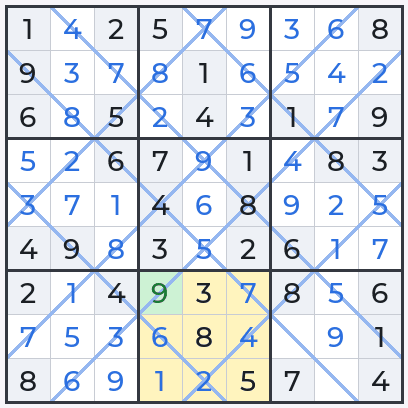

#### Step 46: the 2 in box 9

Box 9 needs a 2. r9c8: row 9 has one (r9c5). Only **r8c7** is left: **r8c7 = 2**.

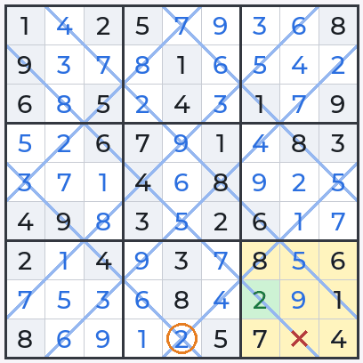

#### Step 47: the 3 in box 9

Box 9 needs a 3, and r9c8 is its last empty cell: **r9c8 = 3**.

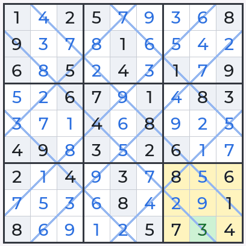

Solved.

<!-- /walkthrough -->
