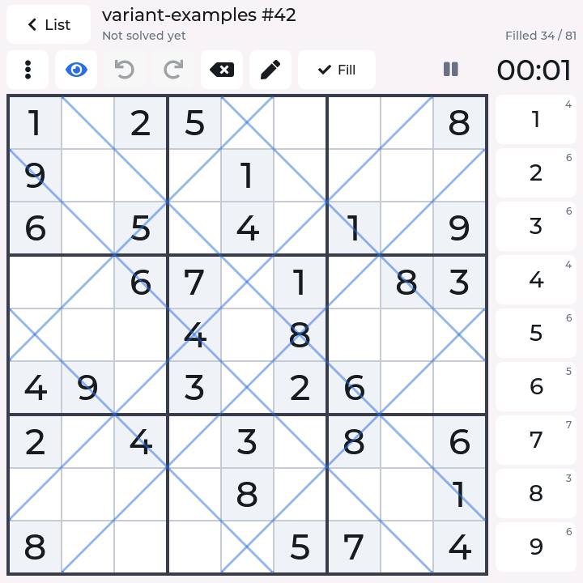

# Argyle

[← All variants](README.md) · [Puzzles](../features-puzzles.md) · [How to play](../how-to-play.md)

## The rules

[Classic](classic.md) rules, plus **eight diagonal lines** in an argyle (diamond) pattern: **no digit repeats along a line**. Four run down to the right, from r1c2, r1c5, r2c1 and r5c1, and four mirror them, down to the left from r1c8, r1c5, r2c9 and r5c9. The long ones have 8 cells and the short ones 5, so unlike X-Sudoku's diagonals they don't hold every digit.

## On the board

- The lines are thin translucent lines in the accent colour, corner to corner across their cells, under the digits.
- Two equal digits on a line turn red, like a repeat in a row.
- Conflicts, hints and the grader count the lines as cells that see each other: "row, column, box or argyle line".
- **Puzzles → ⋮ → New puzzle → Grids → Argyle**.

## How to solve it

- **More cells see each other:** a cell on a line sees up to 7 more cells than in Classic; a cell where two lines cross, up to 12. Check the lines before writing in a candidate.
- **No "every digit" on a line:** a line of 8 misses one digit and a line of 5 misses four, so a line never gives a hidden single by itself. Use it to rule digits out of cells.
- **The crossings:** two lines meet in 8 cells: r1c5, r5c1, r5c9 and r9c5 (where the short lines start and end) and r4c5, r5c4, r5c6, r6c5 around the centre. They see the most, so they're often the first to have one candidate left.

## Worked example

**variant-examples #42**, Argyle Easy (see [Classic](classic.md#worked-example-the-whole-puzzle) for how to import the examples; cells are written r*row*c*column*). The lines are in the screenshot; three matter here:

- the long line from r1c2 down to the right (r1c2, r2c3, r3c4, r4c5, r5c6, r6c7, r7c8, r8c9);
- the short line from r1c5 down to the left (r1c5, r2c4, r3c3, r4c2, r5c1);
- the long line from r2c1 down to the right (r2c1, r3c2, r4c3, r5c4, r6c5, r7c6, r8c7, r9c8).

**Step 1: r3c4.** Row 3 has 1, 4, 5, 6 and 9; column 4 has 3 and 7; that leaves 2 and 8. r3c4 is on the long line from r1c2, which has an 8 in r5c6. **r3c4 = 2**.

**Step 2: r4c2.** Row 4 has 1, 3, 6, 7 and 8; box 4 has a 4; column 2 has a 9; that leaves 2 and 5. r4c2 is on the short line from r1c5, which has a 5 in r3c3. **r4c2 = 2**.

**Step 3: r7c6.** Row 7 has 2, 3, 4, 6 and 8; column 6 has 1 and 5; that leaves 7 and 9. r7c6 is on the long line from r2c1, which has a 9 in r2c1. **r7c6 = 7**.

## The whole puzzle, step by step

<!-- walkthrough -->
<!-- Written by tools/walkthrough.py argyle: edit the script, not this part. -->

The whole puzzle, from the start to the last cell: 47 steps, each one a single (one place left for a digit, or one digit left for a cell), taken in the order a box's single comes first, so not quite the order of the worked example above. Each step has a page of its own, with **Previous** and **Next**: pick one from the list below. In each picture, the unit the step looks at is tinted yellow (for a cell with one digit left: its row, column and box), the new digit is on green, the digits that rule cells out have an **orange ring**, and the empty cells they rule out a **red cross**. Givens are on grey, digits from earlier steps in blue.

1. [the 8 in box 2](argyle/step-01.md)
2. [the 8 in box 1](argyle/step-02.md)
3. [the 2 in box 2](argyle/step-03.md)
4. [the 8 in box 4](argyle/step-04.md)
5. [the 6 in box 5](argyle/step-05.md)
6. [the 9 in box 5](argyle/step-06.md)
7. [the 9 in box 2](argyle/step-07.md)
8. [the 6 in box 2](argyle/step-08.md)
9. [the 3 in box 2](argyle/step-09.md)
10. [the 7 in box 2](argyle/step-10.md)
11. [the 6 in box 3](argyle/step-11.md)
12. [the 5 in box 5](argyle/step-12.md)
13. [the 4 in box 6](argyle/step-13.md)
14. [the 4 in box 3](argyle/step-14.md)
15. [the 4 in box 1](argyle/step-15.md)
16. [the 3 in box 3](argyle/step-16.md)
17. [the 5 in box 3](argyle/step-17.md)
18. [the 2 in box 3](argyle/step-18.md)
19. [the 7 in box 3](argyle/step-19.md)
20. [the 7 in box 6](argyle/step-20.md)
21. [the 5 in box 7](argyle/step-21.md)
22. [the 5 in box 4](argyle/step-22.md)
23. [the 6 in box 7](argyle/step-23.md)
24. [the 2 in box 8](argyle/step-24.md)
25. [the 4 in box 8](argyle/step-25.md)
26. [the 6 in box 8](argyle/step-26.md)
27. [the 7 in box 8](argyle/step-27.md)
28. [the 7 in box 7](argyle/step-28.md)
29. [the 5 in box 9](argyle/step-29.md)
30. [the 5 in box 6](argyle/step-30.md)
31. [the 9 in box 9](argyle/step-31.md)
32. [the 9 in box 6](argyle/step-32.md)
33. [the 2 in box 6](argyle/step-33.md)
34. [the 2 in box 4](argyle/step-34.md)
35. [the 1 in box 6](argyle/step-35.md)
36. [the 9 in box 7](argyle/step-36.md)
37. [the 1 in box 7](argyle/step-37.md)
38. [the 1 in box 4](argyle/step-38.md)
39. [the 7 in box 4](argyle/step-39.md)
40. [the 7 in box 1](argyle/step-40.md)
41. [the 3 in box 1](argyle/step-41.md)
42. [the 3 in box 4](argyle/step-42.md)
43. [the 3 in box 7](argyle/step-43.md)
44. [the 1 in box 8](argyle/step-44.md)
45. [the 9 in box 8](argyle/step-45.md)
46. [the 2 in box 9](argyle/step-46.md)
47. [the 3 in box 9](argyle/step-47.md)

Solved.

<!-- /walkthrough -->
