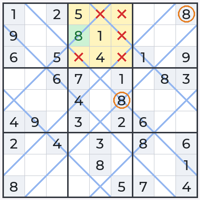

<!-- Written by tools/walkthrough.py argyle: edit the script, not this page. -->
# Argyle, step 1: the 8 in box 2

**Step 1 of 47** · [← The start](../argyle.md#the-whole-puzzle-step-by-step) · [All steps](../argyle.md#the-whole-puzzle-step-by-step) · [Step 2 →](step-02.md)

Box 2 needs an 8. r1c5 and r1c6: row 1 has one (r1c9). r2c6 and r3c6: column 6 has one (r5c6). r3c4: the 8 in r5c6 is on the same argyle line. Only **r2c4** is left: **r2c4 = 8**.

**Step 1 of 47** · [← The start](../argyle.md#the-whole-puzzle-step-by-step) · [All steps](../argyle.md#the-whole-puzzle-step-by-step) · [Step 2 →](step-02.md)
