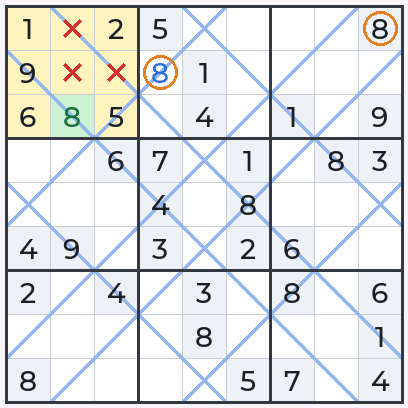

<!-- Written by tools/walkthrough.py argyle: edit the script, not this page. -->
# Argyle, step 2: the 8 in box 1

**Step 2 of 47** · [← Step 1](step-01.md) · [All steps](../argyle.md#the-whole-puzzle-step-by-step) · [Step 3 →](step-03.md)

Box 1 needs an 8. r1c2: row 1 has one (r1c9). r2c2 and r2c3: row 2 has one (r2c4). Only **r3c2** is left: **r3c2 = 8**.

**Step 2 of 47** · [← Step 1](step-01.md) · [All steps](../argyle.md#the-whole-puzzle-step-by-step) · [Step 3 →](step-03.md)
