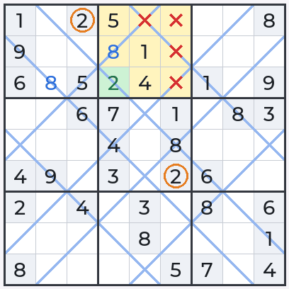

<!-- Written by tools/walkthrough.py argyle: edit the script, not this page. -->
# Argyle, step 3: the 2 in box 2

**Step 3 of 47** · [← Step 2](step-02.md) · [All steps](../argyle.md#the-whole-puzzle-step-by-step) · [Step 4 →](step-04.md)

Box 2 needs a 2. r1c5 and r1c6: row 1 has one (r1c3). r2c6 and r3c6: column 6 has one (r6c6). Only **r3c4** is left: **r3c4 = 2**.

**Step 3 of 47** · [← Step 2](step-02.md) · [All steps](../argyle.md#the-whole-puzzle-step-by-step) · [Step 4 →](step-04.md)
