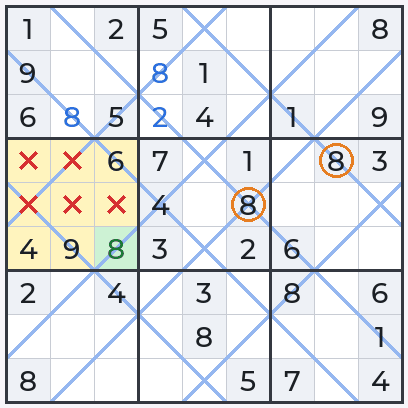

<!-- Written by tools/walkthrough.py argyle: edit the script, not this page. -->
# Argyle, step 4: the 8 in box 4

**Step 4 of 47** · [← Step 3](step-03.md) · [All steps](../argyle.md#the-whole-puzzle-step-by-step) · [Step 5 →](step-05.md)

Box 4 needs an 8. r4c1 and r4c2: row 4 has one (r4c8). r5c1, r5c2 and r5c3: row 5 has one (r5c6). Only **r6c3** is left: **r6c3 = 8**.

**Step 4 of 47** · [← Step 3](step-03.md) · [All steps](../argyle.md#the-whole-puzzle-step-by-step) · [Step 5 →](step-05.md)
