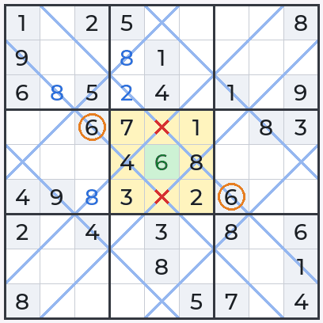

<!-- Written by tools/walkthrough.py argyle: edit the script, not this page. -->
# Argyle, step 5: the 6 in box 5

**Step 5 of 47** · [← Step 4](step-04.md) · [All steps](../argyle.md#the-whole-puzzle-step-by-step) · [Step 6 →](step-06.md)

Box 5 needs a 6. r4c5: row 4 has one (r4c3). r6c5: row 6 has one (r6c7). Only **r5c5** is left: **r5c5 = 6**.

**Step 5 of 47** · [← Step 4](step-04.md) · [All steps](../argyle.md#the-whole-puzzle-step-by-step) · [Step 6 →](step-06.md)
