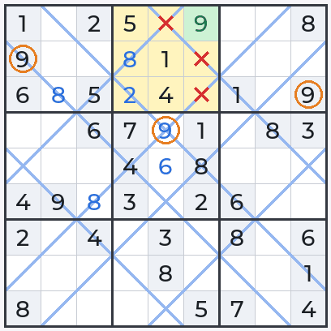

<!-- Written by tools/walkthrough.py argyle: edit the script, not this page. -->
# Argyle, step 7: the 9 in box 2

**Step 7 of 47** · [← Step 6](step-06.md) · [All steps](../argyle.md#the-whole-puzzle-step-by-step) · [Step 8 →](step-08.md)

Box 2 needs a 9. r1c5: column 5 has one (r4c5). r2c6: row 2 has one (r2c1). r3c6: row 3 has one (r3c9). Only **r1c6** is left: **r1c6 = 9**.

**Step 7 of 47** · [← Step 6](step-06.md) · [All steps](../argyle.md#the-whole-puzzle-step-by-step) · [Step 8 →](step-08.md)
