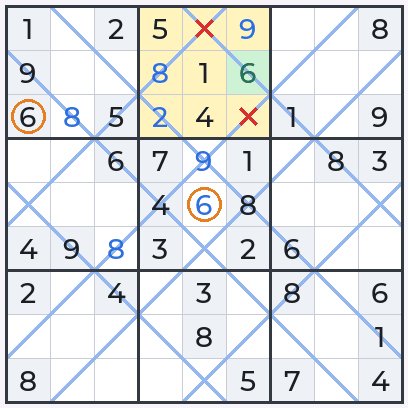

<!-- Written by tools/walkthrough.py argyle: edit the script, not this page. -->
# Argyle, step 8: the 6 in box 2

**Step 8 of 47** · [← Step 7](step-07.md) · [All steps](../argyle.md#the-whole-puzzle-step-by-step) · [Step 9 →](step-09.md)

Box 2 needs a 6. r1c5: column 5 has one (r5c5). r3c6: row 3 has one (r3c1). Only **r2c6** is left: **r2c6 = 6**.

**Step 8 of 47** · [← Step 7](step-07.md) · [All steps](../argyle.md#the-whole-puzzle-step-by-step) · [Step 9 →](step-09.md)
