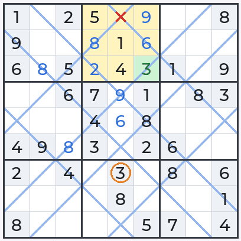

<!-- Written by tools/walkthrough.py argyle: edit the script, not this page. -->
# Argyle, step 9: the 3 in box 2

**Step 9 of 47** · [← Step 8](step-08.md) · [All steps](../argyle.md#the-whole-puzzle-step-by-step) · [Step 10 →](step-10.md)

Box 2 needs a 3. r1c5: column 5 has one (r7c5). Only **r3c6** is left: **r3c6 = 3**.

**Step 9 of 47** · [← Step 8](step-08.md) · [All steps](../argyle.md#the-whole-puzzle-step-by-step) · [Step 10 →](step-10.md)
