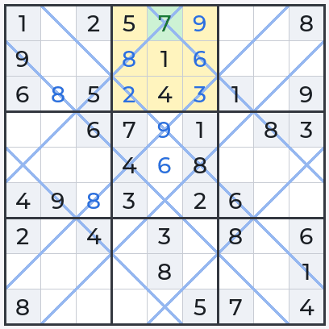

<!-- Written by tools/walkthrough.py argyle: edit the script, not this page. -->
# Argyle, step 10: the 7 in box 2

**Step 10 of 47** · [← Step 9](step-09.md) · [All steps](../argyle.md#the-whole-puzzle-step-by-step) · [Step 11 →](step-11.md)

Box 2 needs a 7, and r1c5 is its last empty cell: **r1c5 = 7**.

**Step 10 of 47** · [← Step 9](step-09.md) · [All steps](../argyle.md#the-whole-puzzle-step-by-step) · [Step 11 →](step-11.md)
