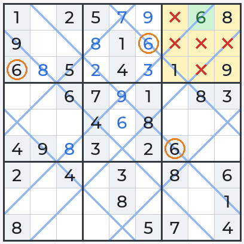

<!-- Written by tools/walkthrough.py argyle: edit the script, not this page. -->
# Argyle, step 11: the 6 in box 3

**Step 11 of 47** · [← Step 10](step-10.md) · [All steps](../argyle.md#the-whole-puzzle-step-by-step) · [Step 12 →](step-12.md)

Box 3 needs a 6. r1c7: column 7 has one (r6c7). r2c7, r2c8 and r2c9: row 2 has one (r2c6). r3c8: row 3 has one (r3c1). Only **r1c8** is left: **r1c8 = 6**.

**Step 11 of 47** · [← Step 10](step-10.md) · [All steps](../argyle.md#the-whole-puzzle-step-by-step) · [Step 12 →](step-12.md)
