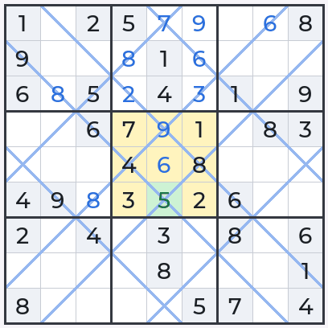

<!-- Written by tools/walkthrough.py argyle: edit the script, not this page. -->
# Argyle, step 12: the 5 in box 5

**Step 12 of 47** · [← Step 11](step-11.md) · [All steps](../argyle.md#the-whole-puzzle-step-by-step) · [Step 13 →](step-13.md)

Box 5 needs a 5, and r6c5 is its last empty cell: **r6c5 = 5**.

**Step 12 of 47** · [← Step 11](step-11.md) · [All steps](../argyle.md#the-whole-puzzle-step-by-step) · [Step 13 →](step-13.md)
