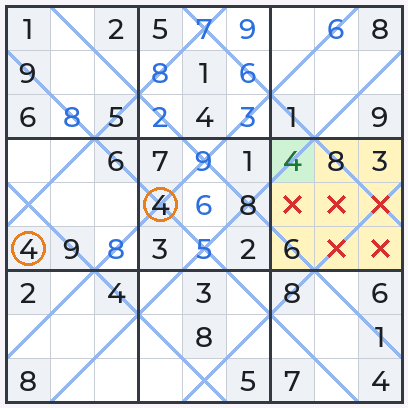

<!-- Written by tools/walkthrough.py argyle: edit the script, not this page. -->
# Argyle, step 13: the 4 in box 6

**Step 13 of 47** · [← Step 12](step-12.md) · [All steps](../argyle.md#the-whole-puzzle-step-by-step) · [Step 14 →](step-14.md)

Box 6 needs a 4. r5c7, r5c8 and r5c9: row 5 has one (r5c4). r6c8 and r6c9: row 6 has one (r6c1). Only **r4c7** is left: **r4c7 = 4**.

**Step 13 of 47** · [← Step 12](step-12.md) · [All steps](../argyle.md#the-whole-puzzle-step-by-step) · [Step 14 →](step-14.md)
