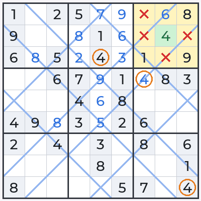

<!-- Written by tools/walkthrough.py argyle: edit the script, not this page. -->
# Argyle, step 14: the 4 in box 3

**Step 14 of 47** · [← Step 13](step-13.md) · [All steps](../argyle.md#the-whole-puzzle-step-by-step) · [Step 15 →](step-15.md)

Box 3 needs a 4. r1c7 and r2c7: column 7 has one (r4c7). r2c9: column 9 has one (r9c9). r3c8: row 3 has one (r3c5). Only **r2c8** is left: **r2c8 = 4**.

**Step 14 of 47** · [← Step 13](step-13.md) · [All steps](../argyle.md#the-whole-puzzle-step-by-step) · [Step 15 →](step-15.md)
