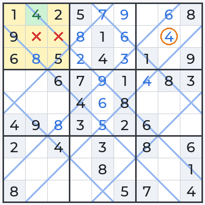

<!-- Written by tools/walkthrough.py argyle: edit the script, not this page. -->
# Argyle, step 15: the 4 in box 1

**Step 15 of 47** · [← Step 14](step-14.md) · [All steps](../argyle.md#the-whole-puzzle-step-by-step) · [Step 16 →](step-16.md)

Box 1 needs a 4. r2c2 and r2c3: row 2 has one (r2c8). Only **r1c2** is left: **r1c2 = 4**.

**Step 15 of 47** · [← Step 14](step-14.md) · [All steps](../argyle.md#the-whole-puzzle-step-by-step) · [Step 16 →](step-16.md)
