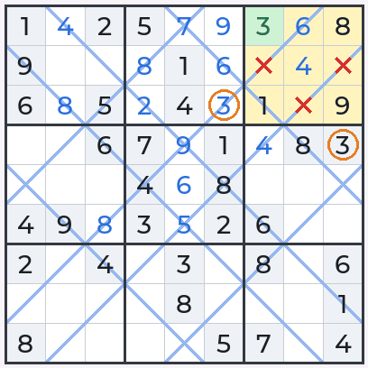

<!-- Written by tools/walkthrough.py argyle: edit the script, not this page. -->
# Argyle, step 16: the 3 in box 3

**Step 16 of 47** · [← Step 15](step-15.md) · [All steps](../argyle.md#the-whole-puzzle-step-by-step) · [Step 17 →](step-17.md)

Box 3 needs a 3. r2c7: the 3 in r3c6 is on the same argyle line. r2c9: column 9 has one (r4c9). r3c8: row 3 has one (r3c6). Only **r1c7** is left: **r1c7 = 3**.

**Step 16 of 47** · [← Step 15](step-15.md) · [All steps](../argyle.md#the-whole-puzzle-step-by-step) · [Step 17 →](step-17.md)
