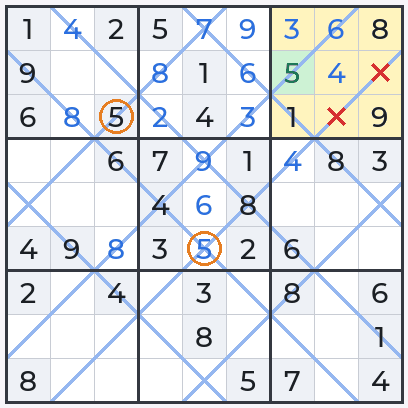

<!-- Written by tools/walkthrough.py argyle: edit the script, not this page. -->
# Argyle, step 17: the 5 in box 3

**Step 17 of 47** · [← Step 16](step-16.md) · [All steps](../argyle.md#the-whole-puzzle-step-by-step) · [Step 18 →](step-18.md)

Box 3 needs a 5. r2c9: the 5 in r6c5 is on the same argyle line. r3c8: row 3 has one (r3c3). Only **r2c7** is left: **r2c7 = 5**.

**Step 17 of 47** · [← Step 16](step-16.md) · [All steps](../argyle.md#the-whole-puzzle-step-by-step) · [Step 18 →](step-18.md)
