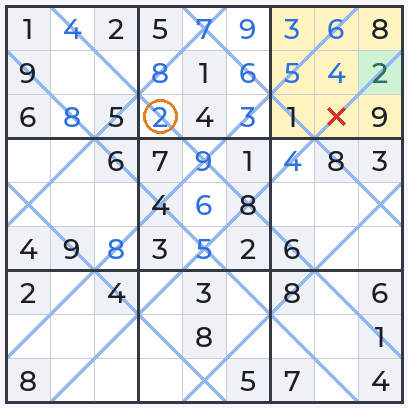

<!-- Written by tools/walkthrough.py argyle: edit the script, not this page. -->
# Argyle, step 18: the 2 in box 3

**Step 18 of 47** · [← Step 17](step-17.md) · [All steps](../argyle.md#the-whole-puzzle-step-by-step) · [Step 19 →](step-19.md)

Box 3 needs a 2. r3c8: row 3 has one (r3c4). Only **r2c9** is left: **r2c9 = 2**.

**Step 18 of 47** · [← Step 17](step-17.md) · [All steps](../argyle.md#the-whole-puzzle-step-by-step) · [Step 19 →](step-19.md)
