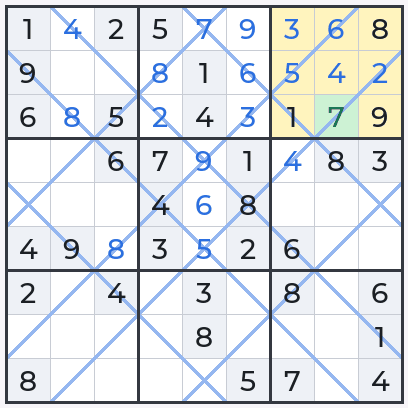

<!-- Written by tools/walkthrough.py argyle: edit the script, not this page. -->
# Argyle, step 19: the 7 in box 3

**Step 19 of 47** · [← Step 18](step-18.md) · [All steps](../argyle.md#the-whole-puzzle-step-by-step) · [Step 20 →](step-20.md)

Box 3 needs a 7, and r3c8 is its last empty cell: **r3c8 = 7**.

**Step 19 of 47** · [← Step 18](step-18.md) · [All steps](../argyle.md#the-whole-puzzle-step-by-step) · [Step 20 →](step-20.md)
