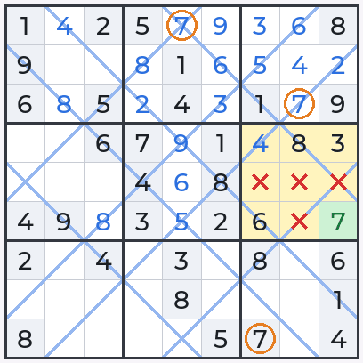

<!-- Written by tools/walkthrough.py argyle: edit the script, not this page. -->
# Argyle, step 20: the 7 in box 6

**Step 20 of 47** · [← Step 19](step-19.md) · [All steps](../argyle.md#the-whole-puzzle-step-by-step) · [Step 21 →](step-21.md)

Box 6 needs a 7. r5c7: column 7 has one (r9c7). r5c8 and r6c8: column 8 has one (r3c8). r5c9: the 7 in r1c5 is on the same argyle line. Only **r6c9** is left: **r6c9 = 7**.

**Step 20 of 47** · [← Step 19](step-19.md) · [All steps](../argyle.md#the-whole-puzzle-step-by-step) · [Step 21 →](step-21.md)
