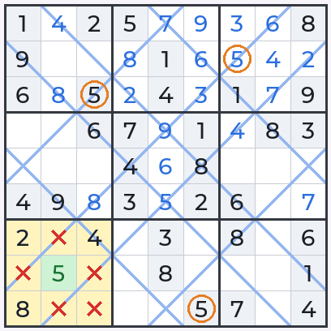

<!-- Written by tools/walkthrough.py argyle: edit the script, not this page. -->
# Argyle, step 21: the 5 in box 7

**Step 21 of 47** · [← Step 20](step-20.md) · [All steps](../argyle.md#the-whole-puzzle-step-by-step) · [Step 22 →](step-22.md)

Box 7 needs a 5. r7c2 and r8c1: the 5 in r2c7 is on the same argyle line. r8c3: column 3 has one (r3c3). r9c2 and r9c3: row 9 has one (r9c6). Only **r8c2** is left: **r8c2 = 5**.

**Step 21 of 47** · [← Step 20](step-20.md) · [All steps](../argyle.md#the-whole-puzzle-step-by-step) · [Step 22 →](step-22.md)
