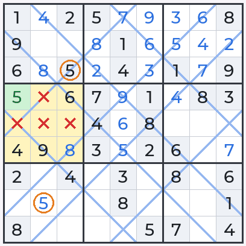

<!-- Written by tools/walkthrough.py argyle: edit the script, not this page. -->
# Argyle, step 22: the 5 in box 4

**Step 22 of 47** · [← Step 21](step-21.md) · [All steps](../argyle.md#the-whole-puzzle-step-by-step) · [Step 23 →](step-23.md)

Box 4 needs a 5. r4c2 and r5c2: column 2 has one (r8c2). r5c1: the 5 in r3c3 is on the same argyle line. r5c3: column 3 has one (r3c3). Only **r4c1** is left: **r4c1 = 5**.

**Step 22 of 47** · [← Step 21](step-21.md) · [All steps](../argyle.md#the-whole-puzzle-step-by-step) · [Step 23 →](step-23.md)
