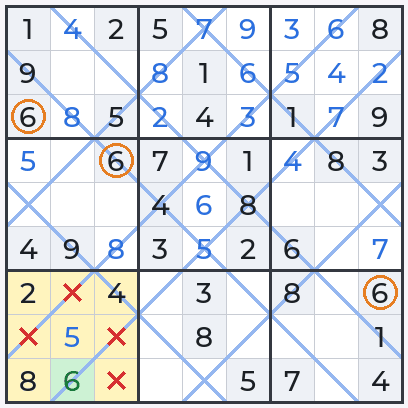

<!-- Written by tools/walkthrough.py argyle: edit the script, not this page. -->
# Argyle, step 23: the 6 in box 7

**Step 23 of 47** · [← Step 22](step-22.md) · [All steps](../argyle.md#the-whole-puzzle-step-by-step) · [Step 24 →](step-24.md)

Box 7 needs a 6. r7c2: row 7 has one (r7c9). r8c1: column 1 has one (r3c1). r8c3 and r9c3: column 3 has one (r4c3). Only **r9c2** is left: **r9c2 = 6**.

**Step 23 of 47** · [← Step 22](step-22.md) · [All steps](../argyle.md#the-whole-puzzle-step-by-step) · [Step 24 →](step-24.md)
