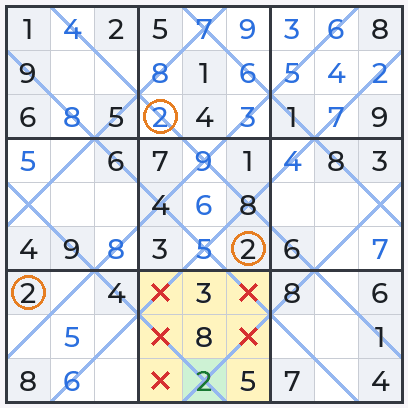

<!-- Written by tools/walkthrough.py argyle: edit the script, not this page. -->
# Argyle, step 24: the 2 in box 8

**Step 24 of 47** · [← Step 23](step-23.md) · [All steps](../argyle.md#the-whole-puzzle-step-by-step) · [Step 25 →](step-25.md)

Box 8 needs a 2. r7c4 and r7c6: row 7 has one (r7c1). r8c4 and r9c4: column 4 has one (r3c4). r8c6: column 6 has one (r6c6). Only **r9c5** is left: **r9c5 = 2**.

**Step 24 of 47** · [← Step 23](step-23.md) · [All steps](../argyle.md#the-whole-puzzle-step-by-step) · [Step 25 →](step-25.md)
