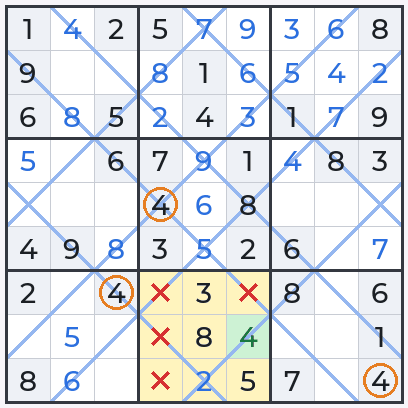

<!-- Written by tools/walkthrough.py argyle: edit the script, not this page. -->
# Argyle, step 25: the 4 in box 8

**Step 25 of 47** · [← Step 24](step-24.md) · [All steps](../argyle.md#the-whole-puzzle-step-by-step) · [Step 26 →](step-26.md)

Box 8 needs a 4. r7c4 and r7c6: row 7 has one (r7c3). r8c4: column 4 has one (r5c4). r9c4: row 9 has one (r9c9). Only **r8c6** is left: **r8c6 = 4**.

**Step 25 of 47** · [← Step 24](step-24.md) · [All steps](../argyle.md#the-whole-puzzle-step-by-step) · [Step 26 →](step-26.md)
