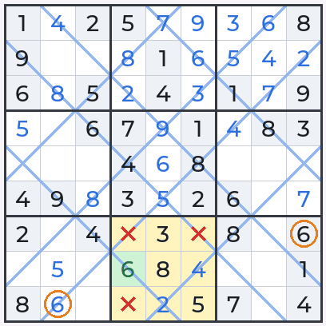

<!-- Written by tools/walkthrough.py argyle: edit the script, not this page. -->
# Argyle, step 26: the 6 in box 8

**Step 26 of 47** · [← Step 25](step-25.md) · [All steps](../argyle.md#the-whole-puzzle-step-by-step) · [Step 27 →](step-27.md)

Box 8 needs a 6. r7c4 and r7c6: row 7 has one (r7c9). r9c4: row 9 has one (r9c2). Only **r8c4** is left: **r8c4 = 6**.

**Step 26 of 47** · [← Step 25](step-25.md) · [All steps](../argyle.md#the-whole-puzzle-step-by-step) · [Step 27 →](step-27.md)
