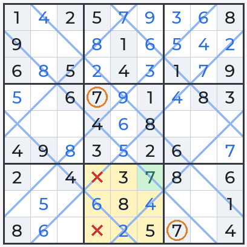

<!-- Written by tools/walkthrough.py argyle: edit the script, not this page. -->
# Argyle, step 27: the 7 in box 8

**Step 27 of 47** · [← Step 26](step-26.md) · [All steps](../argyle.md#the-whole-puzzle-step-by-step) · [Step 28 →](step-28.md)

Box 8 needs a 7. r7c4: column 4 has one (r4c4). r9c4: row 9 has one (r9c7). Only **r7c6** is left: **r7c6 = 7**.

**Step 27 of 47** · [← Step 26](step-26.md) · [All steps](../argyle.md#the-whole-puzzle-step-by-step) · [Step 28 →](step-28.md)
