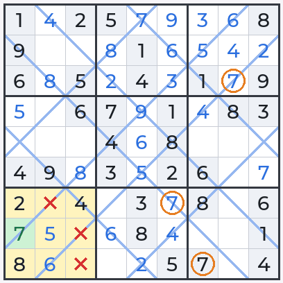

<!-- Written by tools/walkthrough.py argyle: edit the script, not this page. -->
# Argyle, step 28: the 7 in box 7

**Step 28 of 47** · [← Step 27](step-27.md) · [All steps](../argyle.md#the-whole-puzzle-step-by-step) · [Step 29 →](step-29.md)

Box 7 needs a 7. r7c2: row 7 has one (r7c6). r8c3: the 7 in r3c8 is on the same argyle line. r9c3: row 9 has one (r9c7). Only **r8c1** is left: **r8c1 = 7**.

**Step 28 of 47** · [← Step 27](step-27.md) · [All steps](../argyle.md#the-whole-puzzle-step-by-step) · [Step 29 →](step-29.md)
