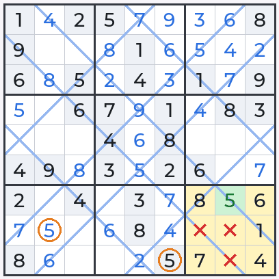

<!-- Written by tools/walkthrough.py argyle: edit the script, not this page. -->
# Argyle, step 29: the 5 in box 9

**Step 29 of 47** · [← Step 28](step-28.md) · [All steps](../argyle.md#the-whole-puzzle-step-by-step) · [Step 30 →](step-30.md)

Box 9 needs a 5. r8c7 and r8c8: row 8 has one (r8c2). r9c8: row 9 has one (r9c6). Only **r7c8** is left: **r7c8 = 5**.

**Step 29 of 47** · [← Step 28](step-28.md) · [All steps](../argyle.md#the-whole-puzzle-step-by-step) · [Step 30 →](step-30.md)
