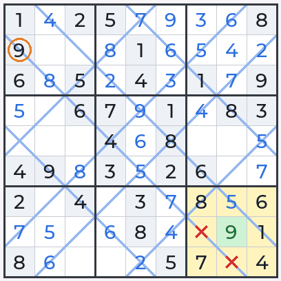

<!-- Written by tools/walkthrough.py argyle: edit the script, not this page. -->
# Argyle, step 31: the 9 in box 9

**Step 31 of 47** · [← Step 30](step-30.md) · [All steps](../argyle.md#the-whole-puzzle-step-by-step) · [Step 32 →](step-32.md)

Box 9 needs a 9. r8c7 and r9c8: the 9 in r2c1 is on the same argyle line. Only **r8c8** is left: **r8c8 = 9**.

**Step 31 of 47** · [← Step 30](step-30.md) · [All steps](../argyle.md#the-whole-puzzle-step-by-step) · [Step 32 →](step-32.md)
