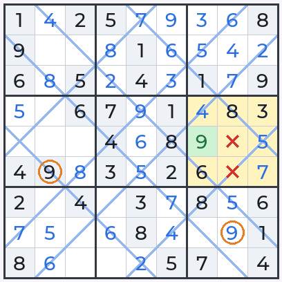

<!-- Written by tools/walkthrough.py argyle: edit the script, not this page. -->
# Argyle, step 32: the 9 in box 6

**Step 32 of 47** · [← Step 31](step-31.md) · [All steps](../argyle.md#the-whole-puzzle-step-by-step) · [Step 33 →](step-33.md)

Box 6 needs a 9. r5c8: column 8 has one (r8c8). r6c8: row 6 has one (r6c2). Only **r5c7** is left: **r5c7 = 9**.

**Step 32 of 47** · [← Step 31](step-31.md) · [All steps](../argyle.md#the-whole-puzzle-step-by-step) · [Step 33 →](step-33.md)
