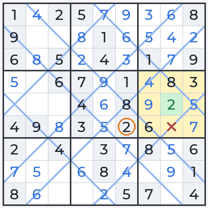

<!-- Written by tools/walkthrough.py argyle: edit the script, not this page. -->
# Argyle, step 33: the 2 in box 6

**Step 33 of 47** · [← Step 32](step-32.md) · [All steps](../argyle.md#the-whole-puzzle-step-by-step) · [Step 34 →](step-34.md)

Box 6 needs a 2. r6c8: row 6 has one (r6c6). Only **r5c8** is left: **r5c8 = 2**.

**Step 33 of 47** · [← Step 32](step-32.md) · [All steps](../argyle.md#the-whole-puzzle-step-by-step) · [Step 34 →](step-34.md)
