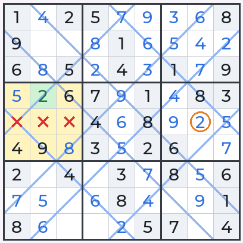

<!-- Written by tools/walkthrough.py argyle: edit the script, not this page. -->
# Argyle, step 34: the 2 in box 4

**Step 34 of 47** · [← Step 33](step-33.md) · [All steps](../argyle.md#the-whole-puzzle-step-by-step) · [Step 35 →](step-35.md)

Box 4 needs a 2. r5c1, r5c2 and r5c3: row 5 has one (r5c8). Only **r4c2** is left: **r4c2 = 2**.

**Step 34 of 47** · [← Step 33](step-33.md) · [All steps](../argyle.md#the-whole-puzzle-step-by-step) · [Step 35 →](step-35.md)
