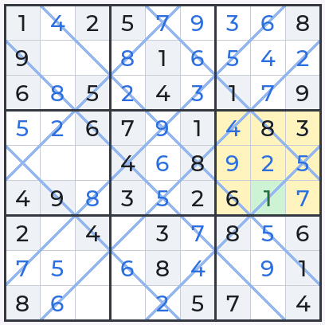

<!-- Written by tools/walkthrough.py argyle: edit the script, not this page. -->
# Argyle, step 35: the 1 in box 6

**Step 35 of 47** · [← Step 34](step-34.md) · [All steps](../argyle.md#the-whole-puzzle-step-by-step) · [Step 36 →](step-36.md)

Box 6 needs a 1, and r6c8 is its last empty cell: **r6c8 = 1**.

**Step 35 of 47** · [← Step 34](step-34.md) · [All steps](../argyle.md#the-whole-puzzle-step-by-step) · [Step 36 →](step-36.md)
