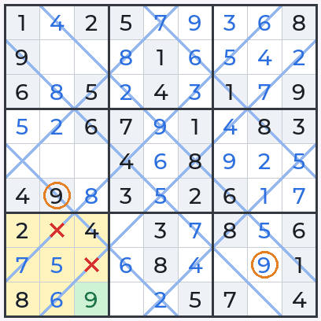

<!-- Written by tools/walkthrough.py argyle: edit the script, not this page. -->
# Argyle, step 36: the 9 in box 7

**Step 36 of 47** · [← Step 35](step-35.md) · [All steps](../argyle.md#the-whole-puzzle-step-by-step) · [Step 37 →](step-37.md)

Box 7 needs a 9. r7c2: column 2 has one (r6c2). r8c3: row 8 has one (r8c8). Only **r9c3** is left: **r9c3 = 9**.

**Step 36 of 47** · [← Step 35](step-35.md) · [All steps](../argyle.md#the-whole-puzzle-step-by-step) · [Step 37 →](step-37.md)
