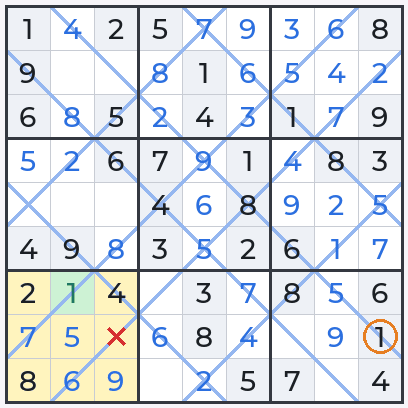

<!-- Written by tools/walkthrough.py argyle: edit the script, not this page. -->
# Argyle, step 37: the 1 in box 7

**Step 37 of 47** · [← Step 36](step-36.md) · [All steps](../argyle.md#the-whole-puzzle-step-by-step) · [Step 38 →](step-38.md)

Box 7 needs a 1. r8c3: row 8 has one (r8c9). Only **r7c2** is left: **r7c2 = 1**.

**Step 37 of 47** · [← Step 36](step-36.md) · [All steps](../argyle.md#the-whole-puzzle-step-by-step) · [Step 38 →](step-38.md)
