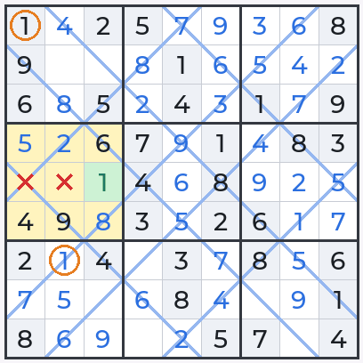

<!-- Written by tools/walkthrough.py argyle: edit the script, not this page. -->
# Argyle, step 38: the 1 in box 4

**Step 38 of 47** · [← Step 37](step-37.md) · [All steps](../argyle.md#the-whole-puzzle-step-by-step) · [Step 39 →](step-39.md)

Box 4 needs a 1. r5c1: column 1 has one (r1c1). r5c2: column 2 has one (r7c2). Only **r5c3** is left: **r5c3 = 1**.

**Step 38 of 47** · [← Step 37](step-37.md) · [All steps](../argyle.md#the-whole-puzzle-step-by-step) · [Step 39 →](step-39.md)
