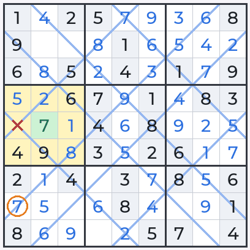

<!-- Written by tools/walkthrough.py argyle: edit the script, not this page. -->
# Argyle, step 39: the 7 in box 4

**Step 39 of 47** · [← Step 38](step-38.md) · [All steps](../argyle.md#the-whole-puzzle-step-by-step) · [Step 40 →](step-40.md)

Box 4 needs a 7. r5c1: column 1 has one (r8c1). Only **r5c2** is left: **r5c2 = 7**.

**Step 39 of 47** · [← Step 38](step-38.md) · [All steps](../argyle.md#the-whole-puzzle-step-by-step) · [Step 40 →](step-40.md)
