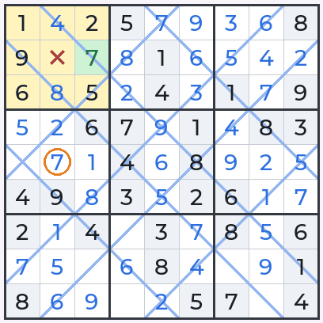

<!-- Written by tools/walkthrough.py argyle: edit the script, not this page. -->
# Argyle, step 40: the 7 in box 1

**Step 40 of 47** · [← Step 39](step-39.md) · [All steps](../argyle.md#the-whole-puzzle-step-by-step) · [Step 41 →](step-41.md)

Box 1 needs a 7. r2c2: column 2 has one (r5c2). Only **r2c3** is left: **r2c3 = 7**.

**Step 40 of 47** · [← Step 39](step-39.md) · [All steps](../argyle.md#the-whole-puzzle-step-by-step) · [Step 41 →](step-41.md)
