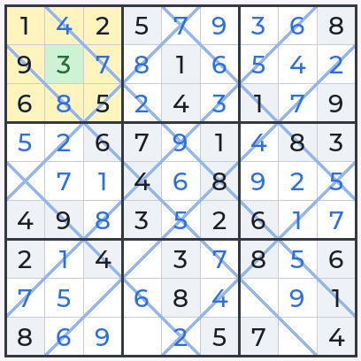

<!-- Written by tools/walkthrough.py argyle: edit the script, not this page. -->
# Argyle, step 41: the 3 in box 1

**Step 41 of 47** · [← Step 40](step-40.md) · [All steps](../argyle.md#the-whole-puzzle-step-by-step) · [Step 42 →](step-42.md)

Box 1 needs a 3, and r2c2 is its last empty cell: **r2c2 = 3**.

**Step 41 of 47** · [← Step 40](step-40.md) · [All steps](../argyle.md#the-whole-puzzle-step-by-step) · [Step 42 →](step-42.md)
