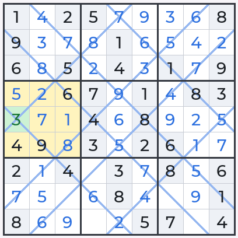

<!-- Written by tools/walkthrough.py argyle: edit the script, not this page. -->
# Argyle, step 42: the 3 in box 4

**Step 42 of 47** · [← Step 41](step-41.md) · [All steps](../argyle.md#the-whole-puzzle-step-by-step) · [Step 43 →](step-43.md)

Box 4 needs a 3, and r5c1 is its last empty cell: **r5c1 = 3**.

**Step 42 of 47** · [← Step 41](step-41.md) · [All steps](../argyle.md#the-whole-puzzle-step-by-step) · [Step 43 →](step-43.md)
