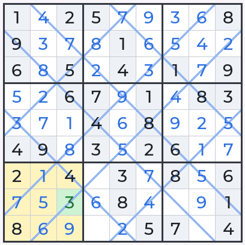

<!-- Written by tools/walkthrough.py argyle: edit the script, not this page. -->
# Argyle, step 43: the 3 in box 7

**Step 43 of 47** · [← Step 42](step-42.md) · [All steps](../argyle.md#the-whole-puzzle-step-by-step) · [Step 44 →](step-44.md)

Box 7 needs a 3, and r8c3 is its last empty cell: **r8c3 = 3**.

**Step 43 of 47** · [← Step 42](step-42.md) · [All steps](../argyle.md#the-whole-puzzle-step-by-step) · [Step 44 →](step-44.md)
