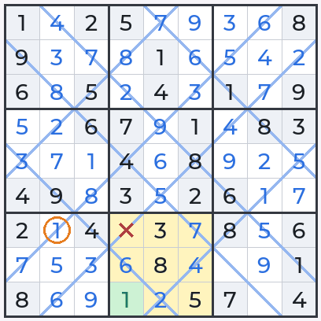

<!-- Written by tools/walkthrough.py argyle: edit the script, not this page. -->
# Argyle, step 44: the 1 in box 8

**Step 44 of 47** · [← Step 43](step-43.md) · [All steps](../argyle.md#the-whole-puzzle-step-by-step) · [Step 45 →](step-45.md)

Box 8 needs a 1. r7c4: row 7 has one (r7c2). Only **r9c4** is left: **r9c4 = 1**.

**Step 44 of 47** · [← Step 43](step-43.md) · [All steps](../argyle.md#the-whole-puzzle-step-by-step) · [Step 45 →](step-45.md)
