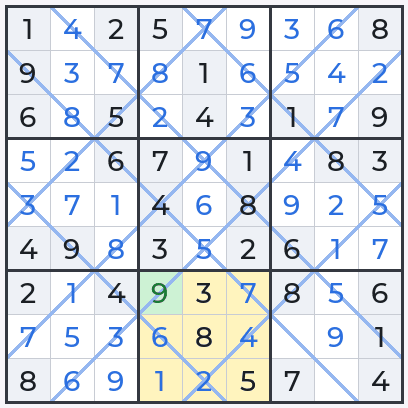

<!-- Written by tools/walkthrough.py argyle: edit the script, not this page. -->
# Argyle, step 45: the 9 in box 8

**Step 45 of 47** · [← Step 44](step-44.md) · [All steps](../argyle.md#the-whole-puzzle-step-by-step) · [Step 46 →](step-46.md)

Box 8 needs a 9, and r7c4 is its last empty cell: **r7c4 = 9**.

**Step 45 of 47** · [← Step 44](step-44.md) · [All steps](../argyle.md#the-whole-puzzle-step-by-step) · [Step 46 →](step-46.md)
