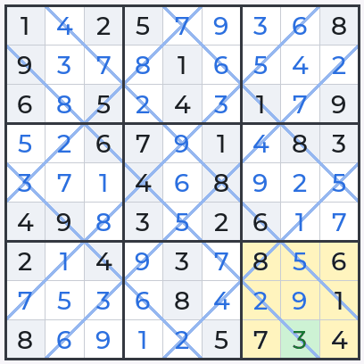

<!-- Written by tools/walkthrough.py argyle: edit the script, not this page. -->
# Argyle, step 47: the 3 in box 9

**Step 47 of 47** · [← Step 46](step-46.md) · [All steps](../argyle.md#the-whole-puzzle-step-by-step) · [All steps](../argyle.md#the-whole-puzzle-step-by-step)

Box 9 needs a 3, and r9c8 is its last empty cell: **r9c8 = 3**.

Solved.

**Step 47 of 47** · [← Step 46](step-46.md) · [All steps](../argyle.md#the-whole-puzzle-step-by-step) · [All steps](../argyle.md#the-whole-puzzle-step-by-step)
