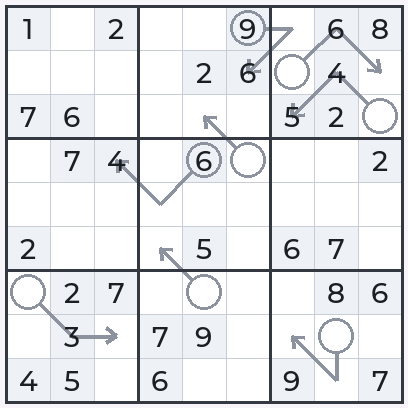

# Arrow

[← All variants](README.md) · [Puzzles](../features-puzzles.md) · [How to play](../how-to-play.md)

## The rules

[Classic](classic.md) rules, plus **arrows**: a circle with a shaft coming out of it, through cells side by side or diagonal. The digits along the **shaft add up to the digit in the circle**. Digits on a shaft can repeat, as long as the rows, columns and boxes allow it (two shaft cells in the same box can't).

## On the board

- Each arrow is a grey ring (the circle) with a thin shaft from its edge and an arrowhead at the end, under the digits.
- A shaft that adds up to more than its circle, or (all filled) to anything else, turns its digits red.
- The grader and hints work out each arrow from both ends: "The arrow's shaft adds up to its circle, so row 2, column 9 can only be 1, 2, 3".
- **Puzzles → ⋮ → New puzzle → Arrow**: 8 arrows (Hard and Expert 10), each with a shaft of 1 to 3 cells.

## How to solve it

- **The circle is at least the shaft's smallest sum:** every shaft cell holds at least 1, so a circle with two shaft cells is at least 2, and at least 3 when the two share a row, column or box (they can't both be 1).
- **A shaft is at most the circle:** with a circle of 5, every shaft cell is at most 4 (or less, with others filled).
- **One cell left:** when the circle and all but one shaft cell are known, the last one is the difference.
- Long shafts force small digits: three shaft cells under a 9 hold small digits only.

## Worked example

**variant-examples #21**, Arrow Easy (see [Classic](classic.md#worked-example-the-whole-puzzle) for how to import the examples; cells are written r*row*c*column*). The arrows are in the screenshot; three matter here:

- circle **r1c6** (a 9), shaft r1c7 and r2c6 (a 6);
- circle **r2c7** (empty), shaft r1c8 (a 6) and r2c9;
- circle **r8c8** (empty), shaft r9c8 and r8c7.

**Step 1: r1c7, on the 9's shaft.** Row 1 has 1, 2, 6, 8 and 9; column 7 has a 5; box 3 has a 4. By the Classic rules r1c7 could be 3 or 7. It's on the shaft of the arrow whose circle is the 9 in r1c6, with the 6 in r2c6: 9 − 6 = 3. **r1c7 = 3**.

**Step 2: r2c9, at the end of a shaft.** Row 2 has 2, 4 and 6; column 9 has 8, 2 and 7; box 3 now has 3, 6, 8, 4, 5 and 2. That leaves 1 and 9. r2c9 is on the shaft of the arrow from r2c7, together with the 6 in r1c8: the shaft adds up to one digit (the circle), so r2c9 is at most 9 − 6 = 3. **r2c9 = 1** (and the circle r2c7 will be 7).

**Step 3: r8c8, a circle.** Row 8 has 3, 7 and 9; column 8 has 2, 4, 6 and 8. That leaves 1 and 5. r8c8 is the circle of an arrow with two shaft cells, r9c8 and r8c7. They're both in box 9, so they can't both be 1: the circle is at least 1 + 2 = 3. **r8c8 = 5**.

## The whole puzzle, step by step

<!-- walkthrough -->
<!-- Written by tools/walkthrough.py arrow: edit the script, not this part. -->

The whole puzzle, from the start to the last cell: 49 steps, each one a single (one place left for a digit, or one digit left for a cell), taken in the order a box's single comes first, so not quite the order of the worked example above. Each step has a page of its own, with **Previous** and **Next**: pick one from the list below. In each picture, the unit the step looks at is tinted yellow (for a cell with one digit left: its row, column and box), the new digit is on green, the digits that rule cells out have an **orange ring**, and the empty cells they rule out a **red cross**. Givens are on grey, digits from earlier steps in blue.

1. [the 4 in box 1](arrow/step-01.md)
2. [the 7 in box 2](arrow/step-02.md)
3. [the 1 in box 3](arrow/step-03.md)
4. [the 3 in box 3](arrow/step-04.md)
5. [the 7 in box 3](arrow/step-05.md)
6. [the 9 in box 3](arrow/step-06.md)
7. [the 7 in box 5](arrow/step-07.md)
8. [the 2 in box 5](arrow/step-08.md)
9. [the 9 in box 7](arrow/step-09.md)
10. [the 1 in box 7](arrow/step-10.md)
11. [the 8 in box 7](arrow/step-11.md)
12. [the 6 in box 7](arrow/step-12.md)
13. [the 6 in box 4](arrow/step-13.md)
14. [the 2 in box 9](arrow/step-14.md)
15. [the 2 in box 8](arrow/step-15.md)
16. [the 8 in box 8](arrow/step-16.md)
17. [the 1 in box 9](arrow/step-17.md)
18. [the 1 in box 8](arrow/step-18.md)
19. [the 3 in box 9](arrow/step-19.md)
20. [the 4 in box 9](arrow/step-20.md)
21. [the 4 in box 6](arrow/step-21.md)
22. [the 8 in box 6](arrow/step-22.md)
23. [the 5 in box 9](arrow/step-23.md)
24. [the 5 in box 6](arrow/step-24.md)
25. [the 5 in box 4](arrow/step-25.md)
26. [the 5 in box 1](arrow/step-26.md)
27. [the 9 in box 1](arrow/step-27.md)
28. [the 8 in box 1](arrow/step-28.md)
29. [the 3 in box 1](arrow/step-29.md)
30. [the 5 in box 2](arrow/step-30.md)
31. [the 8 in box 2](arrow/step-31.md)
32. [the 8 in box 5](arrow/step-32.md)
33. [the 8 in box 4](arrow/step-33.md)
34. [the 1 in box 4](arrow/step-34.md)
35. [the 4 in box 5](arrow/step-35.md)
36. [the 9 in box 5](arrow/step-36.md)
37. [the 1 in box 5](arrow/step-37.md)
38. [the 1 in box 2](arrow/step-38.md)
39. [the 3 in box 5](arrow/step-39.md)
40. [the 3 in box 2](arrow/step-40.md)
41. [the 4 in box 2](arrow/step-41.md)
42. [the 1 in box 6](arrow/step-42.md)
43. [the 3 in box 6](arrow/step-43.md)
44. [the 3 in box 4](arrow/step-44.md)
45. [the 9 in box 4](arrow/step-45.md)
46. [the 9 in box 6](arrow/step-46.md)
47. [the 3 in box 8](arrow/step-47.md)
48. [the 4 in box 8](arrow/step-48.md)
49. [the 5 in box 8](arrow/step-49.md)

Solved.

<!-- /walkthrough -->
