# Arrow

[← All variants](README.md) · [Puzzles](../features-puzzles.md) · [How to play](../how-to-play.md)

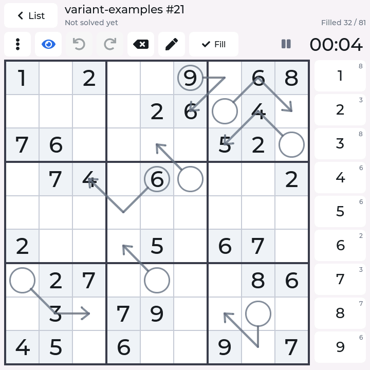

## The rules

[Classic](classic.md) rules, plus **arrows**: a circle with a shaft coming out of it, through cells side by side or diagonal. The digits along the **shaft add up to the digit in the circle**. Digits on a shaft can repeat, as long as the rows, columns and boxes allow it (two shaft cells in the same box can't).

## On the board

- Each arrow is a grey ring (the circle) with a thin shaft from its edge and an arrowhead at the end, under the digits.
- A shaft that adds up to more than its circle, or (all filled) to anything else, turns its digits red.
- The grader and hints work out each arrow from both ends: "The arrow's shaft adds up to its circle, so row 2, column 9 can only be 1, 2, 3".
- **Puzzles → ⋮ → New puzzle → Arrow**: 8 arrows (Hard and Expert 10), each with a shaft of 1 to 3 cells.

## How to solve it

- **The circle is at least the shaft's smallest sum:** every shaft cell holds at least 1, so a circle with two shaft cells is at least 2, and at least 3 when the two share a row, column or box (they can't both be 1).
- **A shaft is at most the circle:** with a circle of 5, every shaft cell is at most 4 (or less, with others filled).
- **One cell left:** when the circle and all but one shaft cell are known, the last one is the difference.
- Long shafts force small digits: three shaft cells under a 9 hold small digits only.

## Worked example

**variant-examples #21**, Arrow Easy (see [Classic](classic.md#worked-example-the-whole-puzzle) for how to import the examples; cells are written r*row*c*column*). The arrows are in the screenshot; three matter here:

- circle **r1c6** (a 9), shaft r1c7 and r2c6 (a 6);
- circle **r2c7** (empty), shaft r1c8 (a 6) and r2c9;
- circle **r8c8** (empty), shaft r9c8 and r8c7.

**Step 1: r1c7, on the 9's shaft.** Row 1 has 1, 2, 6, 8 and 9; column 7 has a 5; box 3 has a 4. By the Classic rules r1c7 could be 3 or 7. It's on the shaft of the arrow whose circle is the 9 in r1c6, with the 6 in r2c6: 9 − 6 = 3. **r1c7 = 3**.

**Step 2: r2c9, at the end of a shaft.** Row 2 has 2, 4 and 6; column 9 has 8, 2 and 7; box 3 now has 3, 6, 8, 4, 5 and 2. That leaves 1 and 9. r2c9 is on the shaft of the arrow from r2c7, together with the 6 in r1c8: the shaft adds up to one digit (the circle), so r2c9 is at most 9 − 6 = 3. **r2c9 = 1** (and the circle r2c7 will be 7).

**Step 3: r8c8, a circle.** Row 8 has 3, 7 and 9; column 8 has 2, 4, 6 and 8. That leaves 1 and 5. r8c8 is the circle of an arrow with two shaft cells, r9c8 and r8c7. They're both in box 9, so they can't both be 1: the circle is at least 1 + 2 = 3. **r8c8 = 5**.

## The whole puzzle, step by step

<!-- walkthrough -->
<!-- Written by tools/walkthrough.py arrow: edit the script, not this part. -->

The whole puzzle, from the start to the last cell: 49 steps, each one a single (one place left for a digit, or one digit left for a cell), taken in the order a box's single comes first, so not quite the order of the worked example above. In each picture, the unit the step looks at is tinted yellow (for a cell with one digit left: its row, column and box), the new digit is on green, the digits that rule cells out have an **orange ring**, and the empty cells they rule out a **red cross**. Givens are on grey, digits from earlier steps in blue.

#### Step 1: the 4 in box 1

Box 1 needs a 4. r2c1, r2c2 and r2c3: row 2 has one (r2c8). r3c3: column 3 has one (r4c3). Only **r1c2** is left: **r1c2 = 4**.

#### Step 2: the 7 in box 2

Box 2 needs a 7. r1c4 and r2c4: column 4 has one (r8c4). r3c4, r3c5 and r3c6: row 3 has one (r3c1). Only **r1c5** is left: **r1c5 = 7**.

#### Step 3: the 1 in box 3

Box 3 needs a 1. r1c7: row 1 has one (r1c1). r2c7: it's an arrow's circle, and its shaft makes at least 7. r3c9: it's an arrow's circle, and its shaft adds up to 9. Only **r2c9** is left: **r2c9 = 1**.

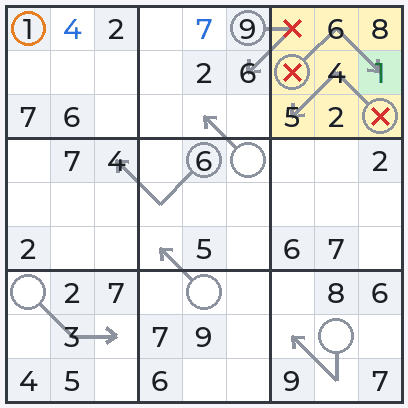

#### Step 4: the 3 in box 3

Box 3 needs a 3. r2c7: it's an arrow's circle, and its shaft adds up to 7. r3c9: it's an arrow's circle, and its shaft adds up to 9. Only **r1c7** is left: **r1c7 = 3**.

#### Step 5: the 7 in box 3

Box 3 needs a 7. r3c9: row 3 has one (r3c1). Only **r2c7** is left: **r2c7 = 7**.

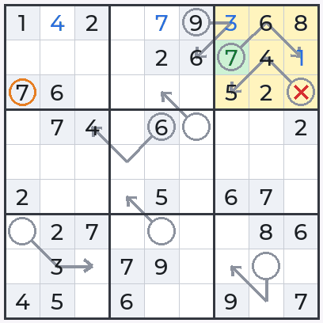

#### Step 6: the 9 in box 3

Box 3 needs a 9, and r3c9 is its last empty cell: **r3c9 = 9**.

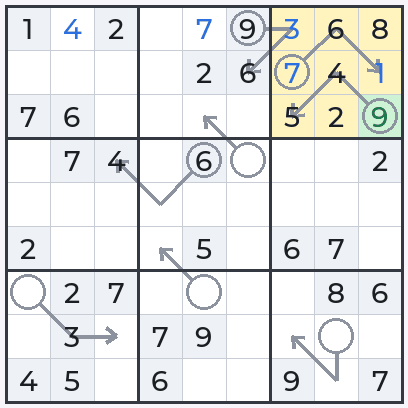

#### Step 7: the 7 in box 5

Box 5 needs a 7. r4c4 and r4c6: row 4 has one (r4c2). r5c4: column 4 has one (r8c4). r5c5: column 5 has one (r1c5). r6c4 and r6c6: row 6 has one (r6c8). Only **r5c6** is left: **r5c6 = 7**.

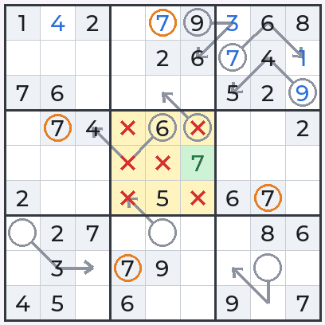

#### Step 8: the 2 in box 5

Box 5 needs a 2. r4c4 and r4c6: row 4 has one (r4c9). r5c5: column 5 has one (r2c5). r6c4 and r6c6: row 6 has one (r6c1). Only **r5c4** is left: **r5c4 = 2**.

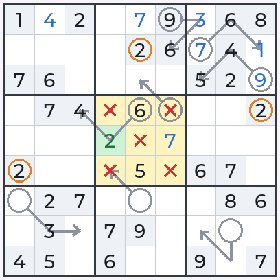

#### Step 9: the 9 in box 7

Box 7 needs a 9. r8c1 and r8c3: row 8 has one (r8c5). r9c3: row 9 has one (r9c7). Only **r7c1** is left: **r7c1 = 9**.

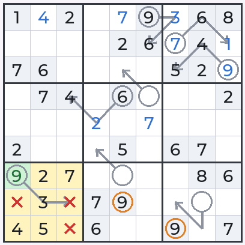

#### Step 10: the 1 in box 7

Box 7 needs a 1. r8c1: column 1 has one (r1c1). r8c3: it's on the shaft of the arrow whose circle is 9 (in r7c1): a 1 would take the shaft to 4. Only **r9c3** is left: **r9c3 = 1**.

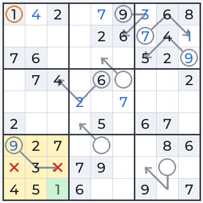

#### Step 11: the 8 in box 7

Box 7 needs an 8. r8c3: it's on the shaft of the arrow whose circle is 9 (in r7c1): an 8 would take the shaft to 11. Only **r8c1** is left: **r8c1 = 8**.

#### Step 12: the 6 in box 7

Box 7 needs a 6, and r8c3 is its last empty cell: **r8c3 = 6**.

#### Step 13: the 6 in box 4

Box 4 needs a 6. r4c1: row 4 has one (r4c5). r5c2: column 2 has one (r3c2). r5c3: column 3 has one (r8c3). r6c2 and r6c3: row 6 has one (r6c7). Only **r5c1** is left: **r5c1 = 6**.

#### Step 14: the 2 in box 9

Box 9 needs a 2. r7c7: row 7 has one (r7c2). r8c8 and r9c8: column 8 has one (r3c8). r8c9: column 9 has one (r4c9). Only **r8c7** is left: **r8c7 = 2**.

#### Step 15: the 2 in box 8

Box 8 needs a 2. r7c4, r7c5 and r7c6: row 7 has one (r7c2). r8c6: row 8 has one (r8c7). r9c5: column 5 has one (r2c5). Only **r9c6** is left: **r9c6 = 2**.

#### Step 16: the 8 in box 8

Box 8 needs an 8. r7c4, r7c5 and r7c6: row 7 has one (r7c8). r8c6: row 8 has one (r8c1). Only **r9c5** is left: **r9c5 = 8**.

#### Step 17: the 1 in box 9

Box 9 needs a 1. r8c9: column 9 has one (r2c9). r9c8: row 9 has one (r9c3). r8c8: it's an arrow's circle, and its shaft makes at least 3. Only **r7c7** is left: **r7c7 = 1**.

#### Step 18: the 1 in box 8

Box 8 needs a 1. r7c4, r7c5 and r7c6: row 7 has one (r7c7). Only **r8c6** is left: **r8c6 = 1**.

#### Step 19: the 3 in box 9

Box 9 needs a 3. r8c8 and r8c9: row 8 has one (r8c2). Only **r9c8** is left: **r9c8 = 3**.

#### Step 20: the 4 in box 9

Box 9 needs a 4. r8c8: column 8 has one (r2c8). Only **r8c9** is left: **r8c9 = 4**.

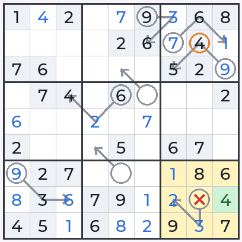

#### Step 21: the 4 in box 6

Box 6 needs a 4. r4c7 and r4c8: row 4 has one (r4c3). r5c8: column 8 has one (r2c8). r5c9 and r6c9: column 9 has one (r8c9). Only **r5c7** is left: **r5c7 = 4**.

#### Step 22: the 8 in box 6

Box 6 needs an 8. r4c8 and r5c8: column 8 has one (r7c8). r5c9 and r6c9: column 9 has one (r1c9). Only **r4c7** is left: **r4c7 = 8**.

#### Step 23: the 5 in box 9

Box 9 needs a 5, and r8c8 is its last empty cell: **r8c8 = 5**.

#### Step 24: the 5 in box 6

Box 6 needs a 5. r4c8 and r5c8: column 8 has one (r8c8). r6c9: row 6 has one (r6c5). Only **r5c9** is left: **r5c9 = 5**.

#### Step 25: the 5 in box 4

Box 4 needs a 5. r5c2 and r5c3: row 5 has one (r5c9). r6c2 and r6c3: row 6 has one (r6c5). Only **r4c1** is left: **r4c1 = 5**.

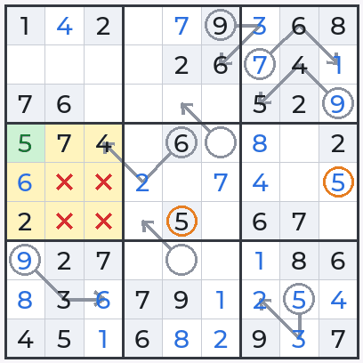

#### Step 26: the 5 in box 1

Box 1 needs a 5. r2c1: column 1 has one (r4c1). r2c2: column 2 has one (r9c2). r3c3: row 3 has one (r3c7). Only **r2c3** is left: **r2c3 = 5**.

#### Step 27: the 9 in box 1

Box 1 needs a 9. r2c1: column 1 has one (r7c1). r3c3: row 3 has one (r3c9). Only **r2c2** is left: **r2c2 = 9**.

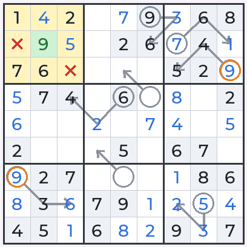

#### Step 28: the 8 in box 1

Box 1 needs an 8. r2c1: column 1 has one (r8c1). Only **r3c3** is left: **r3c3 = 8**.

#### Step 29: the 3 in box 1

Box 1 needs a 3, and r2c1 is its last empty cell: **r2c1 = 3**.

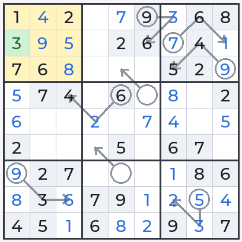

#### Step 30: the 5 in box 2

Box 2 needs a 5. r2c4: row 2 has one (r2c3). r3c4, r3c5 and r3c6: row 3 has one (r3c7). Only **r1c4** is left: **r1c4 = 5**.

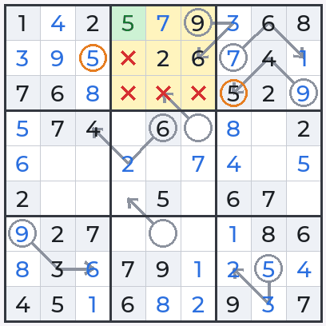

#### Step 31: the 8 in box 2

Box 2 needs an 8. r3c4, r3c5 and r3c6: row 3 has one (r3c3). Only **r2c4** is left: **r2c4 = 8**.

#### Step 32: the 8 in box 5

Box 5 needs an 8. r4c4 and r4c6: row 4 has one (r4c7). r5c5: column 5 has one (r9c5). r6c4: column 4 has one (r2c4). Only **r6c6** is left: **r6c6 = 8**.

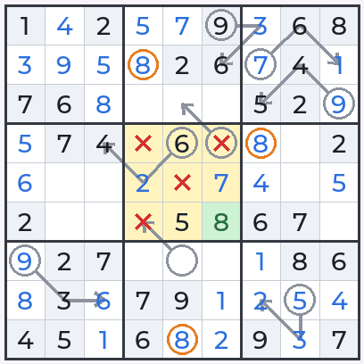

#### Step 33: the 8 in box 4

Box 4 needs an 8. r5c3: column 3 has one (r3c3). r6c2 and r6c3: row 6 has one (r6c6). Only **r5c2** is left: **r5c2 = 8**.

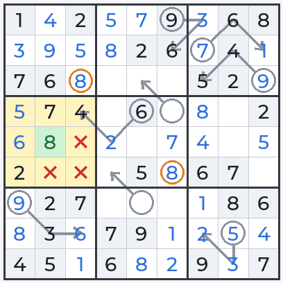

#### Step 34: the 1 in box 4

Box 4 needs a 1. r5c3 and r6c3: column 3 has one (r9c3). Only **r6c2** is left: **r6c2 = 1**.

#### Step 35: the 4 in box 5

Box 5 needs a 4. r4c4 and r4c6: row 4 has one (r4c3). r5c5: row 5 has one (r5c7). Only **r6c4** is left: **r6c4 = 4**.

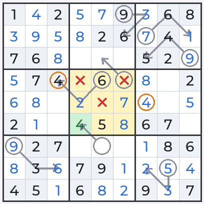

#### Step 36: the 9 in box 5

Box 5 needs a 9. r4c6: column 6 has one (r1c6). r5c5: column 5 has one (r8c5). Only **r4c4** is left: **r4c4 = 9**.

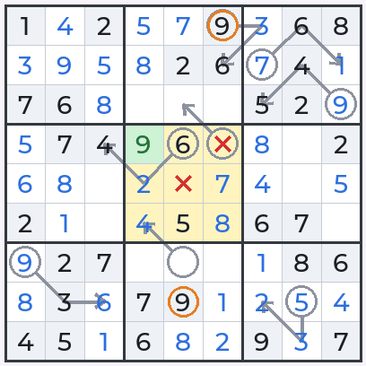

#### Step 37: the 1 in box 5

Box 5 needs a 1. r4c6: column 6 has one (r8c6). Only **r5c5** is left: **r5c5 = 1**.

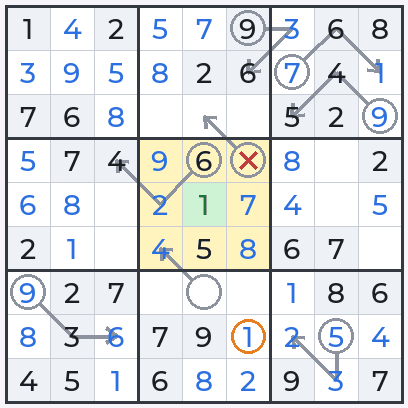

#### Step 38: the 1 in box 2

Box 2 needs a 1. r3c5: column 5 has one (r5c5). r3c6: column 6 has one (r8c6). Only **r3c4** is left: **r3c4 = 1**.

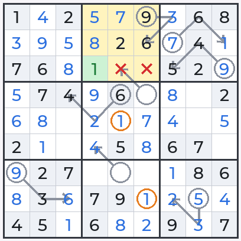

#### Step 39: the 3 in box 5

Box 5 needs a 3, and r4c6 is its last empty cell: **r4c6 = 3**.

#### Step 40: the 3 in box 2

Box 2 needs a 3. r3c6: column 6 has one (r4c6). Only **r3c5** is left: **r3c5 = 3**.

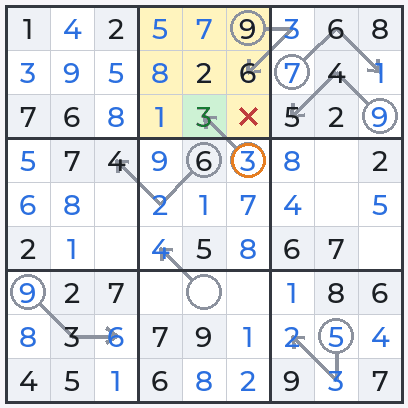

#### Step 41: the 4 in box 2

Box 2 needs a 4, and r3c6 is its last empty cell: **r3c6 = 4**.

#### Step 42: the 1 in box 6

Box 6 needs a 1. r5c8: row 5 has one (r5c5). r6c9: row 6 has one (r6c2). Only **r4c8** is left: **r4c8 = 1**.

#### Step 43: the 3 in box 6

Box 6 needs a 3. r5c8: column 8 has one (r9c8). Only **r6c9** is left: **r6c9 = 3**.

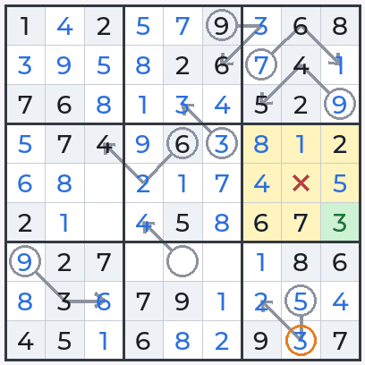

#### Step 44: the 3 in box 4

Box 4 needs a 3. r6c3: row 6 has one (r6c9). Only **r5c3** is left: **r5c3 = 3**.

#### Step 45: the 9 in box 4

Box 4 needs a 9, and r6c3 is its last empty cell: **r6c3 = 9**.

#### Step 46: the 9 in box 6

Box 6 needs a 9, and r5c8 is its last empty cell: **r5c8 = 9**.

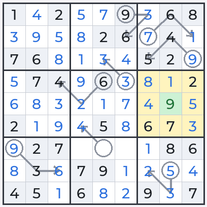

#### Step 47: the 3 in box 8

Box 8 needs a 3. r7c5: column 5 has one (r3c5). r7c6: column 6 has one (r4c6). Only **r7c4** is left: **r7c4 = 3**.

#### Step 48: the 4 in box 8

Box 8 needs a 4. r7c6: column 6 has one (r3c6). Only **r7c5** is left: **r7c5 = 4**.

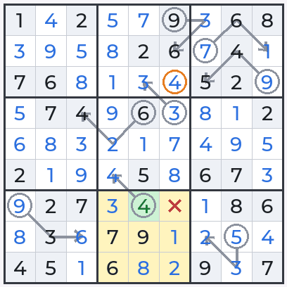

#### Step 49: the 5 in box 8

Box 8 needs a 5, and r7c6 is its last empty cell: **r7c6 = 5**.

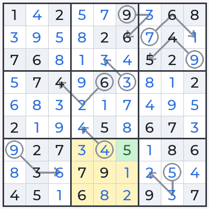

Solved.

<!-- /walkthrough -->
