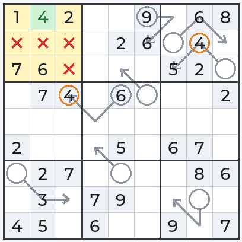

<!-- Written by tools/walkthrough.py arrow: edit the script, not this page. -->
# Arrow, step 1: the 4 in box 1

**Step 1 of 49** · [← The start](../arrow.md#the-whole-puzzle-step-by-step) · [All steps](../arrow.md#the-whole-puzzle-step-by-step) · [Step 2 →](step-02.md)

Box 1 needs a 4. r2c1, r2c2 and r2c3: row 2 has one (r2c8). r3c3: column 3 has one (r4c3). Only **r1c2** is left: **r1c2 = 4**.

**Step 1 of 49** · [← The start](../arrow.md#the-whole-puzzle-step-by-step) · [All steps](../arrow.md#the-whole-puzzle-step-by-step) · [Step 2 →](step-02.md)
