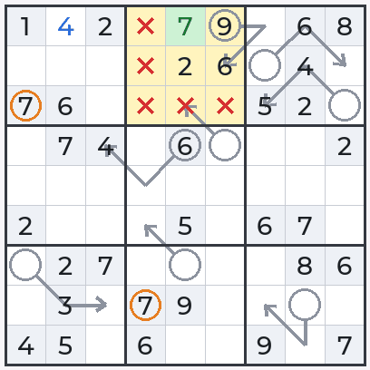

<!-- Written by tools/walkthrough.py arrow: edit the script, not this page. -->
# Arrow, step 2: the 7 in box 2

**Step 2 of 49** · [← Step 1](step-01.md) · [All steps](../arrow.md#the-whole-puzzle-step-by-step) · [Step 3 →](step-03.md)

Box 2 needs a 7. r1c4 and r2c4: column 4 has one (r8c4). r3c4, r3c5 and r3c6: row 3 has one (r3c1). Only **r1c5** is left: **r1c5 = 7**.

**Step 2 of 49** · [← Step 1](step-01.md) · [All steps](../arrow.md#the-whole-puzzle-step-by-step) · [Step 3 →](step-03.md)
